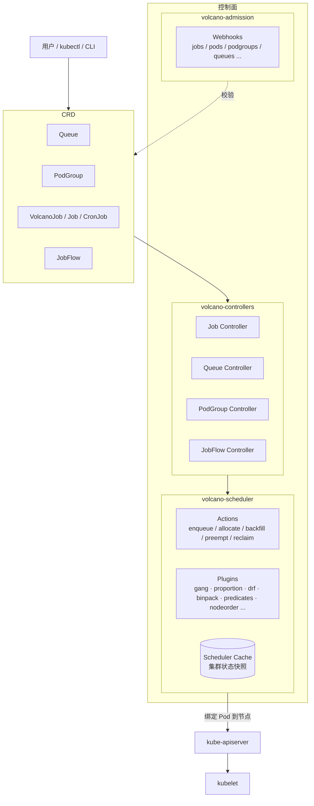

# Volcano 整体架构（共享章节）

> **共享文件。** 各人的个人报告请**引用**本章，例如：
> `详见 [docs/01-architecture.md](../../docs/01-architecture.md) §2`。
> **不要把本章内容复制进自己的报告** —— 复制五遍就会产生五个互相矛盾的版本。
>
> 本章的状态：`骨架已建，内容待全组补充`。
> 每个小节末尾的 `<!-- 负责人：待填 -->` 请认领。写完把状态改成 `已完成`。

---

## 1. 一句话定位

Volcano 是 CNCF incubating 项目，为 Kubernetes 提供**批处理调度能力**：
它在原生 kube-scheduler 之外提供了一套面向 AI/ML、大数据、HPC 等
"一组 Pod 要么一起跑、要么都别跑"场景的调度器与作业管理控制器。

<!-- TODO：补一段「Volcano 与 kube-scheduler 的关系」——是替换、并存还是协作？
     关键点：Pod 通过 spec.schedulerName 选择调度器；Volcano 也支持与原生调度器共存。
     核实位置：docs/design/multi-scheduler.md、docs/user-guide/how_to_configure_scheduler.md -->

<!-- 负责人：待填 -->

## 2. 组件图



<!-- TODO：补上 Volcano Agent（混部场景）在架构中的位置。
     参考：docs/design/agent-scheduler.md、文档站点 colocation 页面 -->

## 3. 代码模块地图

<!-- 用途：让每个人一眼看到"我的模块在哪、和谁相邻、边界在哪"。
     这张表就是选题清单。认领方式见下方 §3.1。 -->

| 目录 | 职责 | 上级设计文档 |
| --- | --- | --- |
| `pkg/scheduler/` | 调度器主体：调度循环、Session 管理 | `docs/design/execution-flow.md` |
| `pkg/scheduler/actions/` | 调度动作：allocate / backfill / enqueue / preempt / reclaim / gangpreempt / gangreclaim / shuffle | `docs/design/preempt-action.md`、`docs/design/reclaim-action.md` |
| `pkg/scheduler/plugins/` | 调度插件（24 个，见 `docs/glossary.md`） | `docs/design/custom-plugin.md`、`docs/design/plugin-conf.md` |
| `pkg/scheduler/framework/` | 插件与 Action 的扩展点接口、Session 定义 | `docs/design/distributed-framework-plugins.md` |
| `pkg/scheduler/cache/` | 集群状态缓存，供调度决策读取 | — |
| `pkg/scheduler/api/` | 调度内部的数据模型（Job / Task / Queue 等） | — |
| `pkg/scheduler/conf/` | 调度器配置的解析与校验 | `docs/design/dynamic-conf.md`、`docs/design/plugin-conf.md` |
| `pkg/scheduler/metrics/` | 调度器指标（Prometheus） | `docs/design/metrics.md` |
| `pkg/scheduler/unschedulable/` | 不可调度作业的缓存与唤醒 | `docs/design/unschedulable-job-cache.md` |
| `pkg/scheduler/gate/` | 调度门控 | `docs/design/scheduling-gates-queue-admission.md` |
| `pkg/controllers/` | 各控制器：作业生命周期、队列、PodGroup、JobFlow 等 | `docs/design/job-api.md`、`docs/design/jobflow/` |
| `pkg/webhooks/admission/` | 准入校验：`jobs` `pods` `podgroups` `queues` `jobflows` `cronjobs` `hypernodes` | — |
| `pkg/cli/` | 命令行工具 | `docs/design/command-line-enhancement.md` |
| `pkg/agent/`、`pkg/agentscheduler/` | 混部场景的节点侧 Agent | `docs/design/agent-scheduler.md` |
| `pkg/networkqos/` | 网络 QoS | — |
| `pkg/metriccollect/`、`pkg/resourceusage/` | 指标采集与资源用量统计 | `docs/design/usage-based-scheduling.md` |
| `pkg/kube/`、`pkg/util/`、`pkg/config/`、`pkg/features/`、`pkg/filewatcher/`、`pkg/signals/`、`pkg/version/` | 公共设施 | — |
| `cmd/` | 各二进制的入口 | — |
| `installer/` | 部署清单与 Helm chart | — |
| `test/e2e/` | 端到端测试 | — |
| `benchmark/` | 性能压测用例与脚本 | `benchmark/README.md` |

### 3.1 模块认领（★可重复认领）

**认领方式 = 改你自己 `meta.yml` 里的字段，不要来改本文件的表格。**
5 个人同时改同一张表必然冲突，所以这张表只做「选题清单」，认领记录在别处。

```yaml
# reports/<你的名字>/meta.yml
name: 你的名字
github: 你的GitHub用户名
title: gang 插件在资源碎片下为何出现 PodGroup 长期 Pending   # 具体到你要回答的问题
module: pkg/scheduler/plugins/gang                        # 从上表挑，建议下沉到插件/Action 级
status: 进行中
updated: 2026-10-10
```

改完运行 `python3 scripts/build_index.py`，根 [README 的报告索引](../README.md#报告索引)
会自动更新 —— **那张表才是唯一的认领汇总**。本文件的模块地图只是可选项清单。

**认领规则：**

1. **可重复认领。** 同一个模块可以由 2 个人同时做，这不是冲突，是交叉验证。
   但两人的 `title` 必须写清各自的角度，例如一个人做「公平性度量」，
   另一个人做「饥饿现象的复现与边界」。
2. **每人至少认领一个模块**，多认领不限。组长负责兜底没被认领的
   （见 [组长手册 §二](组长手册.md)）。
3. **粒度往下沉。** 停在 `pkg/scheduler/` 这一层，写出来一定是"Volcano 调度器概述"——
   两页纸讲完全是人尽皆知的内容，除了「项目结构分析」以外拿不到任何分。
   下沉到**具体插件 / 具体 Action / 具体控制器**，才有可追踪的调用链和可验证的结论。
4. **认领后到群里说一句**（"我认领 X"），组长据此更新兜底清单。

**自检：你的认领合格吗？** 标准是能不能用一句话说清「我要回答什么问题」。

| | 例子 | 判断 |
| --- | --- | --- |
| ❌ | "我分析调度器" | 太大，必然写成概述 |
| ❌ | "我研究 gang 插件" | 没有目标，写出来是代码复述 |
| ✅ | "gang 插件在资源碎片场景下，为什么会出现 PodGroup 长期 Pending" | 有目标、可设计验证、可给结论 |

**自己看清结构**（比读别人的总结更可靠）：

```bash
cd <volcano源码目录>          # 需要已经 checkout 到 v1.15.3
ls pkg/                       # 顶层模块
ls pkg/scheduler/plugins/     # 全部插件
ls pkg/controllers/           # 全部控制器
ls docs/design/               # 上游设计文档（做代码分析时最好的起点）
git log --oneline -20 -- pkg/scheduler/plugins/gang   # 看某模块最近怎么演化的
```

## 4. 默认调度配置（v1.15.3 实测核对值）

默认配置来自 `installer/helm/chart/volcano/config/volcano-scheduler.conf`。
**以下内容已在 `v1.15.3` 上逐字核对**，可以作为报告中的引用依据：

```yaml
actions: "enqueue, allocate, backfill"
tiers:
- plugins:
  - name: priority
  - name: gang
    enablePreemptable: false
  - name: conformance
- plugins:
  - name: overcommit
  - name: drf
    enablePreemptable: false
  - name: predicates
  - name: proportion
  - name: nodeorder
  - name: binpack
```

要点：

- **默认只启用 3 个 Action**（`enqueue, allocate, backfill`）。
  `preempt` / `reclaim` / `gangpreempt` / `gangreclaim` / `shuffle` **默认不启用**，
  做抢占、回收类实验之前必须自己改配置 —— 这是新手最容易踩的坑。
- **24 个插件目录（不含共享工具 `util`）中，默认只启用 9 个**：
  `priority` `gang` `conformance` `overcommit` `drf` `predicates` `proportion` `nodeorder` `binpack`。
  其余需要在配置里显式启用：`capacity`、`task-topology`、`numaaware`、`deviceshare`、
  `rescheduling`、`sla`、`tdm`、`cdp`、`nodegroup`、`network-topology-aware`、`pdb`、
  `resource-strategy-fit`、`resourcequota`、`usage`、`extender`。
- 插件被分成 2 个 tier。

> ⚠️ **待核实**：tier 之间的执行语义（层内插件的调用顺序、层间是否严格串行、
> `enablePreemptable` 的确切作用范围）。
> 核实位置：`pkg/scheduler/framework/` 与 `pkg/scheduler/conf/`。**核实后请回来更新本段。**

<!-- 负责人：待填 -->

## 5. CRD 清单

<!-- TODO：列出 Volcano 引入的 CRD（group/version/kind），并注明各自由哪个控制器处理。
     获取方式：
       ls config/crd/volcano/ config/crd/jobflow/
       kubectl api-resources | grep -i volcano
     注意：上游 README 提到 CRD 位于 config/crd/bases，但在 master 检出中该路径不存在
     （实际为 config/crd/volcano 与 config/crd/jobflow）。这属于「文档与代码不一致」，
     值得在报告里作为一条发现记录，但**先在 v1.15.3 上核实再写**。 -->

<!-- 负责人：待填 -->

## 6. 上游设计文档索引

做代码分析时，**先读 `docs/design/` 里对应的设计文档，再读代码**，效率差好几倍。
以下按主题归类（清单取自本地 master 检出，请以 v1.15.3 为准核对存在性）：

| 主题 | 设计文档 |
| --- | --- |
| 调度流程 | `execution-flow.md`、`prebind.md`、`scheduling-reason.md` |
| 抢占与回收 | `preempt-action.md`、`reclaim-action.md`、`reclaim-design.md`、`gang-aware-eviction-design.md`、`evictablefn-evolution-for-gang-eviction.md`、`preempt-action-support-topology.md` |
| 队列与配额 | `capacity-scheduling.md`、`proportional.md`、`drf.md`、`hdrf.md`、`fairshare.md`、`hierarchical-queue-on-capacity-plugin.md`、`queue-priority.md`、`queue/`、`resourcequota-plugin.md` |
| 拓扑与亲和 | `task-topology-plugin.md`、`Network Topology Aware Scheduling.md`、`numa-aware.md`、`node-group.md`、`node-selector.md`、`node-priority.md` |
| 设备与共享 | `device-sharing.md`、`dynamic-mig.md`、`capacity-dra-support.md` |
| 作业模型 | `job-api.md`、`jobflow/`、`task-order.md`、`task-minavailable.md`、`task-launch-order-within-job.md`、`job-scale-up-down.md`、`minsuccess.md` |
| 插件机制 | `custom-plugin.md`、`plugin-conf.md`、`extender.md`、`distributed-framework-plugins.md` |
| 性能与可观测 | `metrics.md`、`unschedulable-job-cache.md`、`usage-based-scheduling.md`、`rescheduling.md` |
| 混部 | `agent-scheduler.md`、`colocation/`、`cpu-throttle-design.md`、`cpu-careful-regulation.md` |

## 7. 本组的统一口径

<!-- 凡是在这里定下来的东西，个人报告直接引用，不要再自己解释一遍。 -->

| 事项 | 结论 | 依据 |
| --- | --- | --- |
| 代码基线 | v1.15.3 / `d2dd7024f4af3070f9d99d68a78973893908a743` | [ADR-0001](adr/0001-pin-baseline-version.md) |
| Kubernetes 版本 | 待定 | [baseline.md §3.1](../baseline.md) |
| 架构图的画法 | 用 mermaid 源码提交，导出图放各自 `assets/` | [CONTRIBUTING.md](../CONTRIBUTING.md) |
| 性能指标定义 | 待定（需要一份 ADR） | — |
