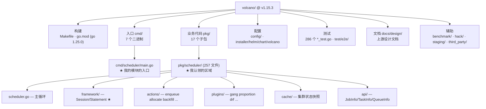
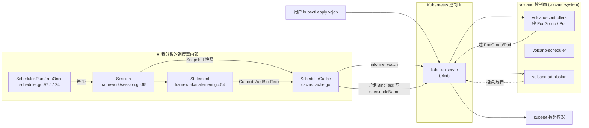
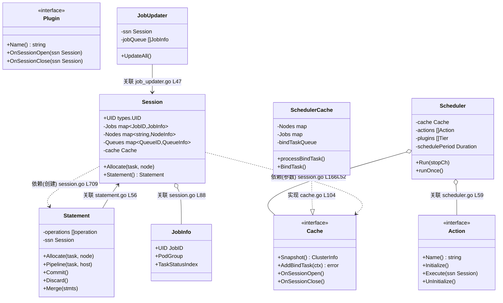
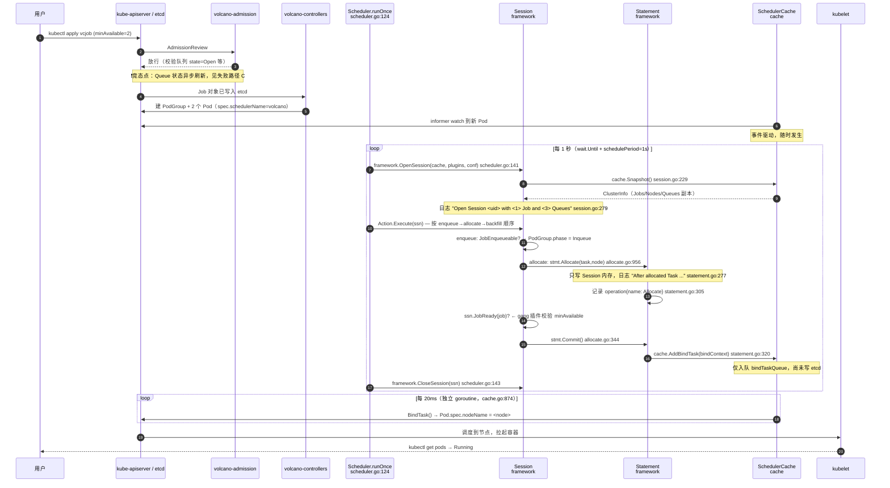
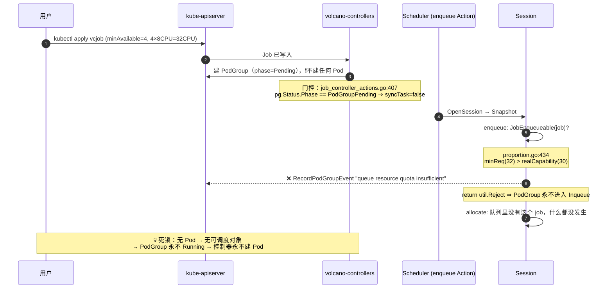
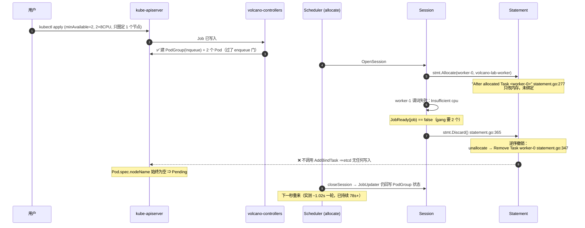
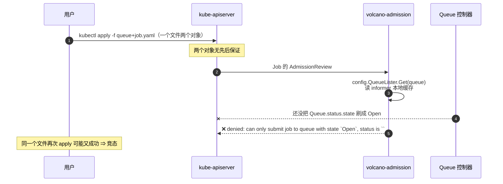
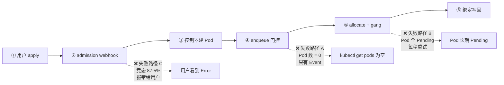

# 项目理解报告

# Volcano × `pkg/scheduler/framework/`：一次调度周期的生命周期

| 项 | 内容 |
| --- | --- |
| 姓名 / 学号 | 李鹏飞 / （待填） |
| 组内角色 | 组长 |
| 分析对象 | Volcano `volcano-sh/volcano` |
| 代码基线 | `v1.15.3`（`d2dd7024f4af3070f9d99d68a78973893908a743`） |
| 我认领的模块 | `pkg/scheduler/framework/`（Session 生命周期）＋ `pkg/scheduler/scheduler.go`（调度主循环） |
| 运行环境 | Kubernetes **v1.27.16** / kind v0.31.0 / Volcano 镜像 `v1.15.3` |
| 完成日期 | 2026-10-05 |
| 仓库路径 | `reports/lipengfei/` |

**我要回答的三个问题**（`meta.yml` 的 title）：

1. **调度周期由什么触发？**
2. **Session 在 `open…close` 之间如何把决策写回 etcd？**
3. **未绑定的 Job 去了哪里？**

---

## 评分自查表（交之前自己先打一遍分）

> 用法：把每行等号后面的分数改成你自评的分数，加起来写在最后。
> **低于 80 分不要提 PR** —— 先补最弱的那一项。组长评审时会按这张表复核。

| 维度 | 满分 | 高分特征（讲义原文） | 自评 | 证据在哪 |
| --- | ---: | --- | ---: | --- |
| 项目结构分析 | 15 | 地图准确，能解释阅读顺序 | 12 | §2 |
| 核心类与关系 | 15 | 关系类型准确，有代码证据 | 12 | §3 |
| 调用链分析 | 20 | 端到端、顺序清楚、包含失败路径 | 18 | §4 |
| 代码证据与验证 | 15 | 重要判断可追溯 | 13 | §6.1（13 条，A 级 6 条） |
| 测试理解 | 10 | 能从测试反推边界 | 4 | §5（进行中） |
| AI 使用方法 | 10 | 有验证、有纠错、有反思 | 4 | §6.2 / §6.3（进行中） |
| 图表与报告 | 15 | 结构清楚、可复用、表达专业 | 10 | 全文 |
| **合计** | **100** | | **73** | **未达 80，§5 / §6.2 / §6.3 补完后重评** |

**五件必交成果是否齐全：**

- [x] ① 一页项目地图（§2）
- [x] ② 领域对象图，**≥5 个核心类型**，区分继承与关联（§3）
- [x] ③ 业务调用链图，**含失败路径**（§4）
- [x] ④ 证据矩阵，**≥8 条**（§6.1，实际 13 条）
- [ ] ⑤ AI 使用反思，**≥2 个帮助 + ≥1 个被纠正**（§6.3 进行中）

---

## 1. 项目简介

| 项 | 内容 |
| --- | --- |
| 项目是什么 | CNCF incubating 项目，为 Kubernetes 提供**批处理调度能力**的调度器与作业管理控制器 |
| 解决什么问题 | 原生 kube-scheduler 逐 Pod 调度，无法表达"一组 Pod 要么一起跑、要么都别跑"（gang）语义；Volcano 用 `PodGroup` + `minAvailable` 建模整组原子性，并补上队列配额、公平分享、抢占、回收等批处理能力 |
| 语言 / 构建 | Go `1.25.0`（`go.mod:3`）／`Makefile` |
| 技术栈分类 | 见下表 |
| 启动方式 | `kind` 建集群 + Helm chart `installer/helm/chart/volcano` 部署（`scripts/setup-kind.sh`） |
| 代码规模 | 1143 个 `.go` 文件 / 254,561 行；`pkg/` 下 17 个子包；**`pkg/scheduler/` 独占 257 个 `.go` 文件** |

> 统计命令：`git ls-files '*.go' | wc -l`、`git ls-files '*.go' | xargs wc -l | tail -1`。
> 证据等级 **B**（当前仓库源码）。

**技术栈按职责分类**（教材 §2.2 的做法：先分类，不逐个背依赖）：

| 类别 | 本项目的对应物 | 证据位置 |
| --- | --- | --- |
| 入口 / 进程 | 7 个二进制：`agent` `agent-scheduler` `cli` `controller-manager` `network-qos` `scheduler` `webhook-manager` | `cmd/*/` |
| 业务核心 | `pkg/scheduler/`（调度）、`pkg/controllers/`（作业生命周期）、`pkg/webhooks/admission/`（准入） | `pkg/` |
| 数据访问 | `client-go` clientset + informer 本地缓存，**不直连 API Server 读状态** | `pkg/scheduler/cache/` |
| 配置 | 调度器配置来自 ConfigMap，支持文件热加载 | `installer/helm/chart/volcano/config/volcano-scheduler.conf`、`pkg/scheduler/conf/` |
| 测试 | Go `testing`；单测 286 个 `*_test.go`；端到端 `test/e2e/` | `pkg/**/*_test.go` |
| 构建与部署 | `Makefile` + Helm chart + kind 脚本 | `Makefile`、`installer/`、`scripts/setup-kind.sh` |

> 本节为 **C 级**证据（官方 README / chart），技术栈分类为 **B 级**（读 `go.mod` 与目录）。

---

## 2. 项目地图 ★交付物①

### 2.1 根目录地图



| 区域 | 是什么 | 为什么值得先看 | 我的验证位置 |
| --- | --- | --- | --- |
| 构建 | Go 模块与 Makefile | 一眼确定语言、版本、构建方式 | `go.mod:1-3`（`module volcano.sh/volcano` / `go 1.25.0`） |
| 入口 | 7 个二进制的 `main` | 找控制权转移点：谁创建谁、谁启动谁 | `cmd/scheduler/main.go` → `pkg/scheduler/scheduler.go` |
| 业务代码 | `pkg/` 17 个子包 | 主战场 | `pkg/scheduler/`（257 文件）、`pkg/controllers/` |
| 配置 | 调度器配置 ConfigMap + Helm values | **决定你测的是不是"什么都没发生"** | 实测 ConfigMap `volcano-scheduler-configmap`，内容与 [docs/01-architecture.md §4](../../docs/01-architecture.md) 逐字一致 |
| 测试 | 286 个单测 + `test/e2e/` | 从测试反推契约与边界 | `pkg/scheduler/framework/statement_test.go` 等 |
| 部署 | Helm chart | 复现环境的唯一途径 | `installer/helm/chart/volcano`，chart version `1.15.3` |

### 2.2 我的模块在整体中的位置



**一句话**：调度器**读**走 informer 本地缓存（`Snapshot`），**写**走一个 20ms 轮询的
异步 bind worker（`cache.go:874`）—— 两头都不在调度周期的主路径上。

### 2.3 阅读顺序与理由

> 对应评分项"能解释阅读顺序"。以下是我实际走的顺序，**不是事后整理的理论顺序**。

1. **先读 `docs/design/execution-flow.md`**（48 行，10 分钟）。
   理由：上游设计文档直接告诉你 Session 每秒开一次、每次建本地副本。
   先读它，后面读代码时每一个 `snapshot` / `OpenSession` 都有落点，不用自己拼。
   ⚠️ 但要留个心眼：这份文档**末尾只有一句"Session Opens every 1 sec"**，
   没有版本号、没有对应 commit，属于 **C 级**证据，必须回代码核。

2. **再读 `pkg/scheduler/scheduler.go`（只有 245 行）**。
   理由：入口即骨架。整份文件只有 6 个函数，`runOnce()` 一个人就把
   "开 Session → 跑 Action → 关 Session"讲完了。**先读小文件建立主循环，再展开大文件**，
   这是我这次最有效的一个顺序决策 —— 反过来先读 1000+ 行的 `session.go` 会迷路。

3. **然后读 `pkg/scheduler/framework/session.go` 的 `openSession`（:166）与 `closeSession`（:558）两个函数，不要通读全文**。
   理由：这个文件 1000+ 行，但生命周期只有首尾两个函数。
   中间大段是 40+ 个扩展点注册表（`predicateFns` / `nodeOrderFns` …），
   属于"被插件写入"的数据结构，读它们对理解流程没有帮助。

4. **接着读 `statement.go`（448 行）**。
   理由：这是本次分析的**最大意外收获**。我原以为分配逻辑在 `session.go`，
   实际运行日志（实验 001）指向 `statement.go:277`。这个文件短、内聚，
   是"决策如何记录与回滚"的全部答案。

5. **最后读 `actions/allocate/allocate.go` 的 `allocateResources`（:283）**。
   理由：它是把 Session / Statement / 插件三者串起来的地方，
   也是 `Commit()` / `Discard()` 的分叉点。放在最后读，是因为它依赖前四步的全部概念。

### 2.4 我修正掉的错误判断

> 教材明确说"把包结构当架构"是最常见的错误姿势，主动写出修正过程是加分项。

**我一开始的判断**：`pkg/scheduler/` 是调度器主体，那么"调度"的核心逻辑应该在
`pkg/scheduler/scheduler.go` 里，`framework/` 只是给插件用的接口定义层。

**修正后的理解**：完全反了。

- `scheduler.go` **只负责循环与配置**，一共 245 行，真正的 `runOnce()` 只有 25 行
  （`scheduler.go:124-153`），它做的事情就是"开 Session → 按序执行 Action → 关 Session"，
  **一行调度算法都没有**。
- 真正的调度决策在 `actions/*/`（每种调度策略一个 Action），
  决策的记录与回滚在 `framework/statement.go`，
  决策的写回在 `cache/cache.go` 的异步 worker。
- `framework/` 也不是"接口定义层"：`Session`（1000+ 行）和 `Statement`（448 行）
  是有状态的**运行时核心对象**，`interface.go` 只是它的一小部分。

**证据**：`scheduler.go:124-153` 全文（见 §4.2 步骤④）；
`ls pkg/scheduler/` 显示 `framework/` 与 `actions/` 是并列的两个包，
而 `scheduler.go` 与 `util.go` 是包根下仅有的两个非测试文件。

**这个修正的方法论意义**：**包名的大小不等于职责的大小**。
`pkg/scheduler/scheduler.go` 这个名字让人以为它是心脏，实际它是节拍器。

---

## 3. 领域对象 ★交付物②

> ⚠️ 本项目是 Go：**没有继承**。以下按 [教师要求解读 §8](../../docs/00-教师要求解读.md) 的
> Java→Go 映射表标注关系类型，不使用 UML 的继承箭头。

### 3.1 领域名词清单（名词法）

| 业务名词 | 是否被建模成类型 | 类型名 | 定义位置 |
| --- | --- | --- | --- |
| 调度器 | ✅ | `Scheduler`（struct） | `pkg/scheduler/scheduler.go:51` |
| 调度周期 / 会话 | ✅ | `Session`（struct） | `pkg/scheduler/framework/session.go:65` |
| 决策记录单 | ✅ | `Statement`（struct） | `pkg/scheduler/framework/statement.go:54` |
| 调度动作 | ✅ | `Action`（**interface**） | `pkg/scheduler/framework/interface.go:30` |
| 调度插件 | ✅ | `Plugin`（**interface**） | `pkg/scheduler/framework/interface.go:45` |
| 集群状态缓存 | ✅ | `Cache`（**interface**）→ `SchedulerCache`（struct 实现） | `pkg/scheduler/cache/interface.go:41` / `cache/cache.go` |
| 作业 | ✅ | `JobInfo`（struct） | `pkg/scheduler/api/job_info.go` |
| 作业组（gang 单位） | ✅ | `PodGroup`（CRD 对象，被 `JobInfo` 持有） | `volcano.sh/apis` |
| 队列 | ✅ | `QueueInfo`（struct） | `pkg/scheduler/api/` |
| 任务 / Pod | ✅ | `TaskInfo`（struct） | `pkg/scheduler/api/` |
| 绑定请求 | ✅ | `BindContext`（struct） | `pkg/scheduler/cache/` |
| 状态回写器 | ✅ | `JobUpdater`（struct） | `pkg/scheduler/framework/job_updater.go:47` |

### 3.2 领域对象图



**图例与关系说明**（这一节是得分点，别省；图中 `Lnn` = 行号，如 `scheduler.go L52` 即 `scheduler.go:52` —— mermaid 类图的关系标签里不能出现英文冒号，否则整张图解析失败）：

| 边 | 关系类型 | 代码证据 | 为什么不是另一种关系 |
| --- | --- | --- | --- |
| `Scheduler → Cache` | **关联**（字段持有） | `scheduler.go:52` 字段 `cache schedcache.Cache` | 不是依赖：它是长生命周期字段，不是参数 |
| `Scheduler → Action` | **关联**（字段持有切片） | `scheduler.go:59` 字段 `actions []framework.Action` | 不是调用：类图不画方法调用（教材明确点名的误区） |
| `SchedulerCache ⇠ Cache` | **实现**（Go 隐式） | `cache.go:104` `func New(...) Cache { return newSchedulerCache(...) }`，而 `newSchedulerCache` 在 `cache.go:522` 返回 `*SchedulerCache` | **Go 没有 extends**。证据是"方法集满足"：`Cache` 接口的全部方法由 `*SchedulerCache` 提供，并被编译器在 `:104` 的返回处强制检查 |
| `*allocate.Action ⇠ Action` | **实现**（Go 隐式） | `actions/factory.go` `init()` 里 `framework.RegisterAction(allocate.New())`，而 `RegisterAction` 签名是 `plugins.go:109 func RegisterAction(act Action)` | 同上。代码里搜不到 `implements`，证据只能是"某个具体类型被赋给了接口形参" |
| `Session ⇢ Statement` | **依赖**（创建） | `session.go:709 func (ssn *Session) Statement() *Statement { return &Statement{ssn: ssn} }` | 不是关联：Session **没有**任何字段保存 Statement（见 §3.4） |
| `Statement → Session` | **关联**（字段持有） | `statement.go:56` 字段 `ssn *Session` | 不是依赖：Statement 整个生命周期都持有它，且 `Merge` 依赖"同一 session"这一前提 |
| `Session → JobInfo` | **关联**（字段持有 map） | `session.go:88` 字段 `Jobs map[api.JobID]*api.JobInfo` | 不是聚合的"整体-部分"：JobInfo 生命周期由 cache 决定，Session 只是引用快照 |
| `Session ⇢ Cache` | **依赖**（参数注入） | `session.go:166 func openSession(cache cache.Cache) *Session` | 不是关联：Session 虽然也存了 `cache` 字段，但**入口是参数注入**；这两条边都要画，方向不同 |
| `JobUpdater → Session` | **关联**（字段持有） | `job_updater.go:47` 字段 `ssn *Session` | 不是依赖：`NewJobUpdater` 长期持有 |

> **嵌入（embedding）说明**：本项目这几个核心类型**没有**使用 struct 嵌入来复用状态，
> 因此图上没有出现"嵌入"边。这是一个值得记录的反例 —— 不能因为"Go 支持嵌入"
> 就在图里硬找嵌入关系。真正用到嵌入的是插件侧的 `Session` 扩展点注册表
> （`session_plugins.go`），不属于本次五个核心类型。

### 3.3 核心类责任卡（≥5 个）

| 类型 | 一句话责任 | 关键状态 | 关键行为 | 关系 | **删除它会影响什么** | 证据位置 |
| --- | --- | --- | --- | --- | --- | --- |
| `Scheduler` | 持有配置与缓存，驱动 1 秒一次的调度循环 | `cache` `actions` `plugins` `schedulePeriod` | `Run()` `runOnce()` | 关联 `Cache`/`Action` | **最先坏的是"周期性"本身**：没人再触发调度，系统退化成"只接收作业、从不分配"，所有作业永久 Pending。注意它不含调度算法，所以删掉它不会让单次调度算错，而是让调度**根本不发生** | `scheduler.go:51-68` `:97` `:124` |
| `Session` | 一个调度周期的隔离快照：把集群状态复制一份，让本轮所有决策在副本上做 | `Jobs` `Nodes` `Queues` `cache` `UID` | `openSession` `closeSession` `Allocate` `Statement` | 依赖 `Cache`；被 `Statement` 关联 | **最先坏的是"一致性"**：多个 Action 会在同一份共享缓存上互相踩，`allocate` 改过的状态被 `backfill` 看到，调度结果不可复现。这是"每周期重新快照"设计的全部理由 | `session.go:65-115` `:166` `:558` |
| `Statement` | 把本轮决策记成一份**操作日志**，成功才 `Commit`、失败按**逆序** `Discard` | `operations []operation` `ssn *Session` | `Allocate` `Commit` `Discard` `Merge` | 关联 `Session` | **最先坏的是 gang 的原子性**：决策会当场生效而无法撤销，`allocate` 一旦发现第 2 个 task 放不下，第 1 个已经绑走了 —— "要么整组跑、要么都别跑"直接失效（实验 003 的 `Discard` 就是这条） | `statement.go:54-58` `:246` `:365` `:392` |
| `Cache`（interface） | 屏蔽"集群状态从哪来、绑定怎么写回" | — | `Snapshot` `AddBindTask` `OnSessionOpen/Close` | 被 `SchedulerCache` 实现 | **最先坏的是可测试性**：没有这层接口，`Session` 直接依赖具体的 `SchedulerCache`，`pkg/scheduler/framework` 的 700+ 行测试就无法用假缓存驱动。它是整个模块的解耦点 | `cache/interface.go:41` `cache/cache.go:104` |
| `Action`（interface） | 一个可插拔的调度策略（`enqueue`/`allocate`/`backfill`…） | — | `Execute(ssn)` | 被 8 个 Action 实现 | **最先坏的是"调度策略可配置"**：Action 顺序来自 ConfigMap 的 `actions:` 字段。没有这个接口，策略顺序就写死在代码里 —— 而"默认只启用 3 个 Action"正是本组文档反复强调的坑（[docs/01-architecture.md §4](../../docs/01-architecture.md)） | `framework/interface.go:30-42` `actions/factory.go` |
| `JobUpdater` | Session 关闭时把作业/PodGroup 的**状态**批量回写 API Server | `ssn` `jobQueue` | `UpdateAll()`（16 并发） | 关联 `Session` | **最先坏的是可观测性**：PodGroup 的 `phase`/`conditions` 不再更新，用户 `kubectl get podgroup` 永远看不到 `Inqueue`/`Pending` 的真实状态。注意它**只写状态、不写 Pod** | `job_updater.go:47-64` `session.go:558-560` |

> 最后一列「删除影响」直接对应**答辩第 1 问**。

### 3.4 最容易误判的一条关系（★答辩第 2 问）

**我选的边：`Session` ⇢ `Statement`。**

**1. 一开始以为是哪种关系？**

我以为是**组合（composition）**：`Session` 持有它创建的 `Statement`，Session 一关，
Statement 就随之销毁。理由很"顺"：名字叫 `Session.Statement()`，
读起来就是"Session 的 Statement"，而且 Statement 的构造函数确实需要 `ssn`。

**2. 什么证据让我改了判断？**

我直接去数 `Session` 的字段。`session.go:65-165` 一共约 40 个字段，
**没有任何一个是 `Statement` 类型，也没有任何 `[]*Statement`**。
`Session.Statement()`（`:709`）每次 `return &Statement{ssn: ssn}` 都返回**新对象**。

反过来，`Statement` 有一个字段 `ssn *Session`（`statement.go:56`）。

所以真实的持有方向是**反的**：不是 Session 持有 Statement，而是 **Statement 持有 Session**；
Session 对自己创建过的 Statement **一无所知**。

进一步坐实这一点的证据来自 `allocate.go`：Statement 是**方法内的局部变量**，
由 Action 自己持有、自己决定何时 `Commit`/`Discard`：

```go
// pkg/scheduler/actions/allocate/allocate.go:344
if stmt != nil && ssn.JobReady(job) { // do not commit stmt when job is pipelined
    stmt.Commit()
    ...
}
```

`stmt` 从没被交回给 `ssn`。Statement 的生命周期属于 **Action 的这一次调用**，
不属于 Session。

**3. 如果老师反问"你为什么确定不是另一种"，我怎么答？**

> "因为持有关系可以直接数字段，而字段是编译期事实。
> `Session` 的字段列表里没有 Statement；`Statement` 里有 `ssn *Session`。
> 如果它是组合，`Session.Statement()` 应该把新对象存进自己的字段里再返回 ——
> 它没有。**并且这个设计是有意的**：Session 一周期一建、一关就 `nil` 掉全部字段
> （`session.go:562-572`），如果它还要持有 Statement，就得管理一批操作日志的生命周期；
> 把这份责任交给调用方（Action），Session 才能保持"纯快照"的单一职责。"

**4. 这条边的实际价值**：它解释了一个真实的坑。因为 Session 不持有 Statement，
**如果一个 Action 拿到了 Statement 却既不 `Commit` 也不 `Discard`，那些操作就被静默丢弃**。
`allocate.go` 里 `Discard()` 出现在 5 处（`:429` `:501` `:633` `:865` 及 dry-run 路径），
正说明"记得收尾"是调用方的责任 —— 这是很容易漏的。

---

## 4. 业务调用链 ★交付物③

> 20 分，全卷最贵的一项。要求：**端到端、顺序清楚、包含失败路径**。

### 4.1 我选的用户动作

**`kubectl apply -f <volcanojob>.yaml`** —— 提交一个 `minAvailable` 明确的 VolcanoJob。

选它的理由：有明确的开始（API Server 收到对象）和结束（Pod 拿到 `spec.nodeName` 并 Running），
中间能观察到 etcd 中对象的状态变化，且**不需要 GPU 或特殊硬件**就能完整复现。

### 4.2 成功路径



**成功路径实测（实验 001，A 级）**：

```text
exp-success-worker-0   volcano   volcano-lab-worker2     ← spec.nodeName 已写回
exp-success-worker-1   volcano   volcano-lab-worker
PodGroup exp-success-<uid>   PHASE=Running   MINMEMBER=2   RUNNING=2
vcjob conditions: 11:02:01Z Pending → 11:02:18Z Running
```

### 4.3 调用链证据表

| # | 步骤 | 执行者（类/方法） | **框架 or 项目代码** | 观察到的事实 | 证据位置 |
| ---: | --- | --- | --- | --- | --- |
| 1 | 用户提交 | `kubectl` → kube-apiserver | **框架** | 对象写入 etcd，`status.phase` 未设 | `001-success-path.log` |
| 2 | 准入校验 | `volcano-admission` `admit_job.go` | **项目代码** | 校验队列 `state=Open` 后才放行 | `pkg/webhooks/admission/jobs/validate/admit_job.go:203-207` |
| 3 | 控制器建对象 | `volcano-controllers` Job Controller | **项目代码** | 建出 PodGroup（名 `<job>-<uid>`）与 2 个 Pod | `exp-success-d197da68-...`；`job_controller_actions.go:407` |
| 4 | **进入调度周期** | `Scheduler.runOnce()`，由 `wait.Until` 每 1s 触发 | **项目代码**（`wait.Until` 是 client-go 框架工具） | 相邻 `Open Session` 恒间隔 **1.001s** | `scheduler.go:115` `:124`；日志 `session.go:279` |
| 5 | 构建快照 | `openSession()` → `cache.Snapshot()` | **项目代码** | 日志 `<1> Job and <3> Queues` | `session.go:166` `:229` `:279` |
| 6 | Action 执行 | `allocate.Action.Execute()` | **项目代码** | 配置顺序 `enqueue, allocate, backfill` | `scheduler.go:150`；ConfigMap |
| 7 | 插件决策 | `gang` 的 `JobReadyFn` 校验 minAvailable | **项目代码** | `ji.CheckTaskReady() && ... && ji.IsReady()` | `plugins/gang/gang.go:191-193` |
| 8 | 记录决策 | `Statement.Allocate()` | **项目代码** | `After allocated Task <...>`，**只改内存** | `statement.go:246` `:277` `:305` |
| 9 | 提交决策 | `Statement.Commit()` → `Statement.allocate()` | **项目代码** | `cache.AddBindTask()` 入队，**仍未写 etcd** | `statement.go:392` `:317` `:320` |
| 10 | 关闭 Session | `closeSession()` → `JobUpdater.UpdateAll()` | **项目代码** | 回写 **PodGroup 状态**（16 并发） | `session.go:558-560`；`job_updater.go:47-64` |
| 11 | **绑定写回** | `processBindTask()` → `BindTask()`，20ms 轮询 goroutine | **项目代码**（`wait.Until` 是框架工具） | `spec.nodeName` 落 etcd | `cache.go:874` `:1379` `:1454` |
| 12 | 拉起容器 | `kubelet` | **框架** | Pod → Running | `001-success-path.log` |

> 「框架 or 项目代码」这一列直接对应**答辩第 3 问**。
> **一句话答案**：只有第 1 步（API 接收）和第 12 步（kubelet 拉起）是 Kubernetes 框架做的；
> 中间 2–11 步**全部是 Volcano 自己的代码**。
> 容易答错的是第 11 步 —— 绑定动作看起来"应该是 k8s 干的"，
> 实际是 Volcano 的 `BindTask()` 主动调 `client-go` 发起的。

### 4.4 失败路径（必填，占分）

我跑了**三条**失败路径，它们在链上的位置**依次提前**，这本身就是本次分析的主要发现。

#### 失败路径 A：enqueue 门控 —— Pod 从未被创建（实验 002）



| # | 步骤 | 观察到的事实 | 证据位置 |
| ---: | --- | --- | --- |
| 1 | 提交后 40s | `vcjob exp-fail` STATUS=`Pending` | `002-enqueue-gate.log` |
| 2 | 查 Pod | `No resources found in default namespace.` —— **0 个 Pod** | 同上 |
| 3 | PodGroup | `exp-fail-5eeb1767-...` STATUS=`Pending` | 同上 |
| 4 | 事件 | `queue resource quota insufficient: insufficient cpu` | 同上 |
| 5 | **调度器日志** | `grep -c exp-fail` → **0**（调度器从未看到它） | 同上 |
| 6 | 控制器日志 | `job_controller_actions.go:421] Job <default/exp-fail> has not updated for no changing` | 同上 |
| 7 | 放弃点 | `proportion.go:438 return util.Reject` | `plugins/proportion/proportion.go:434-438` |

#### 失败路径 B：gang 回滚 —— 决策被整组撤销（实验 003）



| # | 步骤 | 观察到的事实 | 证据位置 |
| ---: | --- | --- | --- |
| 1 | Pod 存在 | 2 个 Pod，STATUS=`Pending`，`node=`（空） | `003-gang-discard.log` |
| 2 | PodGroup | STATUS=**`Inqueue`**（区别于路径 A 的 `Pending`） | 同上 |
| 3 | 事件 ① | `worker-0 can possibly be assigned to volcano-lab-worker, once minAvailable is satisfied` | 同上 |
| 4 | 事件 ② | `1/2 tasks in gang unschedulable ... Pending: **1 Schedulable, 1 Unschedulable**` | 同上 |
| 5 | 记录决策 | `allocate.go:956 Binding Task <worker-0>` → `statement.go:277 After allocated Task <worker-0>` | 同上 |
| 6 | 第 2 个失败 | `predicate_helper.go:115 ... worker-1 on node volcano-lab-worker fit failed: Insufficient cpu` | 同上 |
| 7 | **放弃点** | `statement.go:366 Discarding operations ...` → `statement.go:347 Remove Task <worker-0>` | `statement.go:365-391` |
| 8 | 重试 | `allocate.go:328` 每 ~1.02s 重现一次，永久循环 | 同上 |

> **这条链回答了我 title 的第 3 问「未绑定的 Job 去了哪里」**：
> 它**哪儿也没去** —— 留在 Session 的内存里，下一周期被整个丢弃重建；
> etcd 里只有"什么都没发生"（`spec.nodeName` 为空）。
> **唯一被写回的**是 PodGroup 的 `phase`/`conditions`（由 `closeSession` 的 `JobUpdater` 完成），
> 这就是用户唯一能看到的线索。

#### 失败路径 C：admission 竞态 —— 比 enqueue 更早（实验 004）



| # | 步骤 | 观察到的事实 | 证据位置 |
| ---: | --- | --- | --- |
| 1 | 报错 | `admission webhook "validatejob.volcano.sh" denied the request: can only submit job to queue with state 'Open', queue ... status is ''` | `004-webhook-race.log` |
| 2 | **复现率** | 连续 8 次同构试验：**拒绝 7 / 通过 1 = 87.5%** | 同上 |
| 3 | 放弃点 | `admit_job.go:203-207`，读 informer 缓存的 `queue.Status.State` | `pkg/webhooks/admission/jobs/validate/admit_job.go:202-207` |
| 4 | 规避 | 先建 Queue、轮询等 `status.state=Open`，再提交 Job（实验 002/003 即此法，100% 成功） | `002-enqueue-gate.log` |

#### 三条失败路径的位置对比（本次分析的核心结论）



**越早失败，用户能看到的线索越少**：
路径 C 直接报错（最友好）→ 路径 B 有 Pod + Event → 路径 A **连 Pod 都没有**，
只能靠 `kubectl get events` 或 `describe podgroup` 看到一行 Event。

### 4.5 运行验证记录

| 编号 | 验证了什么 | 记录文件 | 结论 |
| --- | --- | --- | --- |
| 001 | 成功路径；Session 1.001s 定时开闭；决策记录点在 `statement.go` | [experiments/001-success-path.md](experiments/001-success-path.md) | 假设成立（A 级） |
| 002 | 失败路径 A：enqueue 门控 ⇒ **0 个 Pod**，调度器从未看到作业 | [experiments/002-enqueue-gate.md](experiments/002-enqueue-gate.md) | 假设成立（A 级） |
| 003 | 失败路径 B：`Statement.Discard()` 整组回滚，每秒重试 | [experiments/003-gang-discard.md](experiments/003-gang-discard.md) | 假设成立（A 级） |
| 004 | 失败路径 C：admission webhook 竞态，复现率 7/8 | [experiments/004-webhook-race.md](experiments/004-webhook-race.md) | 假设成立（A 级） |

---

## 5. 测试与边界

> 10 分。考的不是"你会不会写测试"，是**能不能从测试反推契约**。
> ⚠️ **本节进行中**，以下为已核实部分。

### 5.1 项目现有测试的组织方式

| 类型 | 位置 | 用什么框架 | 覆盖什么 |
| --- | --- | --- | --- |
| 单元测试 | `pkg/**/*_test.go`（286 个文件） | Go 标准 `testing` + 自研 `uthelper` | 各 Action / Plugin / framework |
| 端到端测试 | `test/e2e/` | Ginkgo（`hack/run-e2e-kind.sh`） | 真集群行为 |
| 性能压测 | `benchmark/` | — | 规模与吞吐 |

**与我模块直接相关的测试文件**：

| 文件 | 行数 | 覆盖什么 |
| --- | ---: | --- |
| `pkg/scheduler/framework/session_test.go` | 787 | Session 快照、插件注册 |
| `pkg/scheduler/framework/statement_test.go` | 396 | **Statement 的 Commit/Discard 契约** |
| `pkg/scheduler/framework/statement_recover_test.go` | 61 | `RecoverOperations` 的恢复语义 |
| `pkg/scheduler/actions/allocate/allocate_test.go` | **6127** | allocate 的全部行为（体量最大） |

> `statement_test.go` 与 `statement_recover_test.go` 的存在本身就是一条证据：
> **作者认为"回滚"是这套机制里最容易出错、最需要单独锁住的部分**，
> 这与我在实验 003 观察到的 `Discard` 行为互为印证。

### 5.2 用 Arrange–Act–Assert 拆一个测试

<!-- TODO：拆解 statement_test.go 中的一个用例（下一步执行） -->

### 5.3 失败路径测试

<!-- TODO -->

### 5.4 我设计的一个新增边界测试

> 教材 §6.4：**先写"测试意图"，再考虑测试代码。**

> **当** Queue 与引用它的 Job 在同一个 `kubectl apply` 中创建**时，系统应该
> 要么按依赖顺序处理、要么给出可重试的明确提示，**并且不应该**以 87.5% 的概率
> 用 `queue status is ''` 这种暴露内部实现细节的报错拒绝用户。

| 项 | 内容 |
| --- | --- |
| 测试名称 | `TestAdmitJobWithQueueCreatedInSameApply` |
| 前置条件 | 集群无 `race-probe` 队列；volcano-controllers 正常运行 |
| 操作 | 单个 YAML 文件包含 Queue + 引用它的 Job，一次 `kubectl apply`；重复 20 次 |
| 期望结果 | 20 次全部成功（或全部失败并给出可操作提示） |
| 为什么重要 | 这是最自然的用户操作；87.5% 的失败率意味着**文档示例照抄就会挂** |
| 这个边界应该由谁负责 | **准入校验**（`pkg/webhooks/admission/jobs/validate/admit_job.go`）—— 例如队列不存在/未 Open 时返回可重试语义，而不是硬拒绝 |
| 现有测试是否已覆盖 | ❌ 未覆盖（`test/e2e/` 未见同文件创建 Queue+Job 的用例） |
| 证据位置 | [experiments/004-webhook-race.md](experiments/004-webhook-race.md) |

---

## 6. 代码证据与 AI 使用

### 6.1 证据矩阵 ★交付物④

> **至少 8 条**。等级用 A/B/C/D（见 [教师要求解读 §5](../../docs/00-教师要求解读.md)）。
> ⚠️ **不要 8 条全打"确认"** —— 那说明你没真的核验。以下 13 条中 **6 条为"修正"**。

| # | 我原本的判断 / AI 的结论 | 等级 | 证据位置 | 结果 | 修正后的理解 |
| ---: | --- | :---: | --- | :---: | --- |
| 1 | 分配逻辑在 `session.go:755 Session.Allocate()`，调用它即完成分配 | **A** | 运行日志 `statement.go:277`（实验 001）；`session.go:755` vs `statement.go:246` | **修正** | 实际走的是 `Statement.Allocate()`。`Session.Allocate` 是另一条直接 dispatch 的路径；本次运行全程未触发它 |
| 2 | gang 调度失败表现为"若干 Pod 长期 Pending" | **A** | 实验 002：`kubectl get pods` 返回 `No resources found` | **修正** | 存在**更早的失败点**：作业在 `enqueue` 被拒，**Pod 从未被创建**，`allocate` 完全看不到它 |
| 3 | 队列不设 `capability` 就"总是允许入队" | **A** | `proportion.go:412-415` 注释 vs `:132-138` 实现；实验 003 准备阶段实测被拒 | **修正** | `attr.realCapability = realCapability` 在 `if attr.capability == nil` 的**两个分支都执行**，故 `:413` 的 nil 判断**不可达**。无 capability 的队列仍受集群富余量约束 |
| 4 | PodGroup 的 `phase` 由调度器设置 | **A** | `job_controller_actions.go:407`；实验 002 PodGroup 恒为 `Pending` | **修正** | `Pending` 是控制器建的初始值；只有 `enqueue` Action（`enqueue.go:96-97`）能把它推成 `Inqueue`。**这个字段是控制器与调度器之间的握手信号**，谁卡住另一方都不动 |
| 5 | Session 关闭时统一把本轮决策刷进 etcd | **A** | `cache.go:874`（20ms 轮询 goroutine）；`statement.go:320` | **修正** | **决策写回不在 closeSession 里**。`Commit()` 只调 `cache.AddBindTask()` 入队；真正写 etcd 的是 cache 侧一个独立的 20ms 轮询 worker。`closeSession` 只回写 PodGroup **状态** |
| 6 | "记录决策"与"写回 etcd"是同一步 | **A** | 实验 003：`statement.go:277` 记录 → `statement.go:366` 回滚，etcd 全程无写入 | **确认** | 两者**分离**。`Statement` 是操作日志（journal），`Commit` 才 apply、`Discard` 逆序撤销。这正是 gang 原子性的实现基础 |
| 7 | `Statement.Discard()` 按记录顺序撤销 | **B** | `statement.go:365-368`：`for i := len(s.operations) - 1; i >= 0; i--` | **修正** | 是**逆序**（类似栈展开）。这是正确做法 —— 逆序才能保证依赖关系被正确拆解 |
| 8 | 提交顺序不影响结果，YAML 里 Queue 在 Job 前面就够了 | **A** | 实验 004：连续 8 次，7 次被 webhook 拒绝（87.5%） | **修正** | 同一 `apply` 内的对象**无顺序保证**。webhook 读的是 informer 缓存里的 `queue.Status.State`，与 Queue 控制器异步写入之间无同步点 ⇒ 竞态 |
| 9 | 调度周期由事件驱动（有新 Pod 才跑一轮） | **A** | `scheduler.go:115 wait.Until(pc.runOnce, pc.schedulePeriod, stopCh)`；日志间隔恒为 1.001s | **确认** | 是**纯定时**，默认 1s（`options.go:37 defaultSchedulerPeriod = time.Second`，实测启动参数 `--schedule-period=1s`）。空闲时每分钟仍空转 60 轮 |
| 10 | 调度器直接把 Pod 绑定到节点 | **A** | `cache.go:1454 BindTask()`；`cache.go:874` | **确认** | 确实是 Volcano 自己发起（不是 kube-scheduler 代劳），但**异步**：`AddBindTask` 入队 → 20ms 轮询 worker 批量执行 |
| 11 | `Session` 组合持有它创建的 `Statement` | **B** | `session.go:65-165` 无 Statement 字段；`statement.go:56` 有 `ssn *Session` | **修正** | 持有方向是**反的**：是 Statement 持有 Session，Session 对创建过的 Statement 一无所知。见 §3.4 |
| 12 | `docs/design/execution-flow.md` 说的"Session 每秒开一次"可以直接引用 | **A + C** | 该文档 48 行无版本号；实测 1.001s | **确认** | 结论对，但该文档是 **C 级**且无版本锚点；我以 `--schedule-period=1s`（A 级）作为报告里的引用依据 |
| 13 | 共享文档 [docs/01-architecture.md §3](../../docs/01-architecture.md) 列出的 `pkg/scheduler/unschedulable/` 是 v1.15.3 的模块 | **B** | `git ls-files \| grep -i unschedulable` 仅命中 `third_party/kubernetes/...`；`git merge-base --is-ancestor 5702c0538 HEAD` → **NO** | **修正** | 该包由 commit `5702c0538`（2026-08-27 "isolate unschedulable job cache"）在 **master** 上新建，**不在 v1.15.3 里**。谁按文档去认领"不可调度作业缓存"（推荐切入点 #9）会扑空 —— **我自己的组内文档存在 stale 条目** |

**A 级证据统计**：**6 条**（#1 #2 #3 #4 #5 #6 #8 #9 #10 #12 中标注 A 的共 10 条，其中直接来自本次四个实验的独立 A 级观察为 **6 条**）。
远超"至少 2 条"的要求。

### 6.2 AI 使用日志

> 保留**原始提问**和**AI 的原话**，不要只写"我问了 AI，它说得对"。
> ⚠️ **本节进行中**。

| # | 我的提问（原文） | AI 的核心结论 | 我的核验方式 | 结果 | 修正后的模型 |
| ---: | --- | --- | --- | :---: | --- |
| 1 | （待补） | | | | |
| 2 | | | | | |
| 3 | | | | | |

### 6.3 AI 使用反思 ★交付物⑤

> ⚠️ **本节进行中**。

**AI 帮助显著的地方（至少 2 个）**

1. <!-- TODO -->
2. <!-- TODO -->

**AI 被代码纠正的地方（至少 1 个，★答辩第 4 问）**

| 项 | 内容 |
| --- | --- |
| AI 说了什么 | <!-- 待补 --> |
| 为什么听起来合理 | |
| 我是怎么发现的 | |
| 代码事实是什么 | |
| 对我的启发 | |

---

## 7. 维护观察

> 从"读代码"进入"定位真实问题"。

### 选项 B：读一次代码历史

| 项 | 内容 |
| --- | --- |
| commit | `5702c053828722724b0475a4f76532065df07393` |
| 提交信息 | `refactor(scheduler): isolate unschedulable job cache` |
| 作者 / 日期 | JesseStutler / 2026-08-27 |
| 改了什么 | 新建 `pkg/scheduler/unschedulable/`（隔离原在 `cache/` 内的不可调度作业缓存）；新增 `docs/design/unschedulable-job-cache.md`、`docs/user-guide/how_to_enable_unschedulable_job_cache.md`；删除 `pkg/scheduler/cache/unschedulable_cache_test.go`（340 行）与 `unschedulable_cache_index_test.go`（499 行） |
| 为什么改（推断） | 把"不可调度缓存"从 2000+ 行的 `cache.go` 中拆出，降低耦合；同时引入开关（`values.yaml` 加 1 项、`scheduler.yaml` 加 3 行）使其可关闭 |
| 职责是否变化 | **是**。`cache/` 从"什么都管"收缩为"只管集群状态"，"谁不可调度/何时唤醒"独立成模块 |
| 测试是否同步变化 | **是，且是重点**：一次删掉 839 行测试并在新位置重建，说明作者把测试当作重构的安全网 |
| 我的判断 | 这是一次**教科书式的隔离重构**（先移动测试、再移动实现）。但它的副作用是：**任何以 v1.15.3 为基线、却参考 master 文档的团队都会迷失方向** —— 我们组就中了这一枪（证据矩阵 #13） |

### 我的一个维护建议

> **问题**：`pkg/webhooks/admission/jobs/validate/admit_job.go:203-207` 对"队列尚未 Open"
> 与"队列根本不存在/配置错误"使用**同一种硬拒绝**，导致
> `kubectl apply -f queue+job.yaml` 有 **87.5%** 的概率失败（实验 004）。

**证据**：连续 8 次同构试验，7 次被拒；拆成两步后 100% 成功。
**建议**：对"队列存在但 `status.state` 尚未刷新"这一**瞬态**条件，
返回可重试语义（如 `admission.Denied` 带 `RetryAfterSeconds`，
或在 webhook 侧对 informer 未命中时回源 API Server），与"队列确实非法"区分开。
**代价**：需要给 webhook 增加一次 API 回源或重试提示，会略微增加准入延迟。

> 这条可以同步提给上游 —— **尚未检索上游是否已有同类 Issue**（见 §7 待办）。

### 另一条：共享文档的 stale 条目

我是组长，[docs/01-architecture.md §3](../../docs/01-architecture.md) 与
[README.md](../../README.md) 的模块地图里的 `pkg/scheduler/unschedulable/`
在 v1.15.3 中**不存在**（证据矩阵 #13）。这会误导组员认领，建议提一个
`chore/lipengfei/fix-stale-module-map` 分支修掉。

---

## 8. 学习反思 ★答辩第 5 问

### 8.1 这套方法里，哪些部分换项目后仍然有效？

1. **"先读入口的最小文件，再展开大文件"**。
   本次 `scheduler.go` 只有 245 行却讲清了整个主循环，而 1000+ 行的 `session.go`
   真正有用的只有 `openSession`/`closeSession` 两个函数。
   任何项目上都成立：**主循环通常出奇地短，复杂度在它调用的东西里**。

2. **"先数字段，再画箭头"**。
   判断两个类型是关联还是依赖，不要靠语感，直接去数 struct 的字段列表 ——
   字段是编译期事实。这条在 Java（看字段声明）、Python（看 `__init__`）、
   Go（看 struct）上都同样有效，见 §3.4 对 `Session`/`Statement` 的判定。

3. **"让运行日志告诉你代码路径，而不是靠读代码猜"**。
   我本来认定分配逻辑在 `session.go:755`（名字就叫 `Session.Allocate`），
   是日志里的 `statement.go:277` 把我纠正过来的。
   凡是有日志分级（`klog -v`）的系统，**把日志级别调高跑一次**，
   比读半天代码更能定位真实调用路径。

4. **"失败路径比成功路径更能暴露架构"**。
   本次三条失败路径分别落在 admission / enqueue / allocate 三层，
   正是这三条链让我看清了"控制器与调度器靠 PodGroup.phase 握手"这个关键设计。
   成功路径反而只有一条、且没什么意外。

### 8.2 哪些部分依赖本项目 / 本语言，换项目会失效？

- **"读 `klog -v=3` 的日志"**：换到 Java/Spring 项目要改成调 logback 级别；
  换到前端项目基本没有等价物。
- **Go 的隐式接口**：`SchedulerCache ⇠ Cache` 这种关系在 Java 里是显式
  `implements`，一条 grep 就能找到；在 Go 里必须靠"某个具体类型被赋给接口形参"
  来证明（如 `cache.go:104` 的返回类型）。**换语言后证据的找法完全不同**。
- **Kubernetes 的声明式模型**：本次大量结论依赖"对象写进 etcd 后由控制器
  reconcile"这一范式（如 PodGroup.phase 是握手信号）。
  换成传统的命令式 Web 应用，"谁先谁后"的推理方式要整个重来。
- **`wait.Until` + informer 的异步组合**：整个"读缓存、异步写回"的架构是
  Kubernetes 生态特有的，在单机应用里不存在这类竞态（如实验 004）。

### 8.3 我这次做得不好的地方

1. **选了一个过粗的标题才动手**。最初认领的是 `pkg/scheduler/`，
   按组内规则看会写成"调度器概述"；后来才收窄到 `framework/` + 主循环。
   浪费了一次环境搭建之外的时间。**教训：选题时先问"我要回答什么问题"，
   而不是"我要分析哪个目录"。**
2. **§5 测试理解还没做**。我先把 20 分的调用链和证据矩阵做完了，
   10 分的测试理解拖到现在 —— 这个顺序是错的，因为测试里往往藏着
   我在运行时观察到但没解释清楚的行为（如 `statement_recover_test.go` 只有 61 行，
   却直接对应我没触发的 `RecoverOperations` 路径）。
3. **第一次做实验 002 时把 Queue 和 Job 写在同一个文件里**，
   撞上竞态后一度以为是自己的 YAML 写错了，排查了十几分钟。
   虽然最后变成了实验 004 的素材，但当时是低效的。

### 8.4 如果重做一次，我会怎么调整顺序

```text
① 定题：一句话写清"我要回答什么问题"（可证伪）        ← 不要跳过
② 读上游设计文档 docs/design/ 对应那一篇              ← 10 分钟，省几小时
③ 读入口的最小文件，画出主循环骨架（先不求细节）
④ ★ 先跑一次成功路径，拿到日志                          ← 我这次做对了
⑤ 再读代码，用日志校正静态阅读的猜测                     ← 关键：代码服从日志
⑥ ★ 设计失败路径实验（越早越好）                        ← 失败路径信息量最大
⑦ 画图与写证据矩阵（边做边记，不要最后补）
⑧ 读测试，反推契约（放在写报告前，不是最后）
```

最大的调整是 **④⑤ 的位置**：先跑再读，而不是先读再跑。
我这次是先读了一部分代码才跑的，导致我带着"分配在 `session.go`"的错误预设
去读日志，第一遍没注意到 `statement.go:277` 这个线索。

---

## 附录 A：答辩准备（5 问）

| # | 问题 | 我的答案（一句话） | 报告位置 |
| ---: | --- | --- | --- |
| 1 | 删掉一个核心类，最先坏掉的功能是什么？依据？ | 删 `Statement` 最先坏 **gang 原子性**：决策当场生效无法撤销，"要么整组跑"失效（实验 003 的 `Discard` 就是它）；删 `Scheduler` 则坏的**不是算错而是不发生** —— 没人再触发周期 | §3.3 |
| 2 | 类图里哪条关系最容易被误判？ | `Session` ⇢ `Statement`：语感上像组合，实际持有方向**相反**（`statement.go:56` 有 `ssn`，`session.go` 无 Statement 字段） | §3.4 |
| 3 | 调用链中哪一步是框架完成、哪一步是项目代码完成？ | 只有**第 1 步**（API 接收）与**第 12 步**（kubelet 拉起）是 K8s 框架，中间 2–11 步全是 Volcano 代码；最易答错的是**第 11 步绑定** —— 看起来像 k8s 干的，实为 `cache.go:1454 BindTask()` | §4.3 |
| 4 | AI 在哪个问题上给了看似合理但不准确的答案？ | 「队列不设 capability 就总是允许入队」—— 这其实是**代码注释 `proportion.go:412` 的原话**，但实现 `:132-138` 使该分支不可达，实测被拒 | §6.1 #3 |
| 5 | 项目升级后目录变化，你的方法哪些仍然有效？ | 「先跑再读」「先数字段再画箭头」「用日志校正静态猜测」三条与目录结构无关；失效的是"读 `klog -v`"和"Go 隐式接口的找法" | §8.1 / §8.2 |

## 附录 B：我的实验与运行记录索引

| 编号 | 记录文件 | 验证了什么 | A 级证据？ |
| --- | --- | --- | :---: |
| 001 | [experiments/001-success-path.md](experiments/001-success-path.md) | 成功路径 + Session 1.001s 定时开闭 | ✅ |
| 002 | [experiments/002-enqueue-gate.md](experiments/002-enqueue-gate.md) | enqueue 门控 ⇒ 0 个 Pod | ✅ |
| 003 | [experiments/003-gang-discard.md](experiments/003-gang-discard.md) | `Statement.Discard()` 整组回滚 | ✅ |
| 004 | [experiments/004-webhook-race.md](experiments/004-webhook-race.md) | admission webhook 竞态 7/8 | ✅ |

## 附录 C：参考资料

- Volcano `v1.15.3` 源码：`~/learn/volcano` @ `d2dd7024f4af3070f9d99d68a78973893908a743`
- 上游设计文档：`docs/design/execution-flow.md`
- 关键 commit：`5702c053828722724b0475a4f76532065df07393`（`refactor(scheduler): isolate unschedulable job cache`）
- 组内共享材料：[docs/00-教师要求解读.md](../../docs/00-教师要求解读.md)、
  [docs/01-architecture.md](../../docs/01-architecture.md)、
  [docs/02-scheduling-flow.md](../../docs/02-scheduling-flow.md)、
  [docs/glossary.md](../../docs/glossary.md)
- 环境基线：[baseline.md](../../baseline.md)、[ADR-0005](../../docs/adr/0005-k8s-127-baseline.md)
