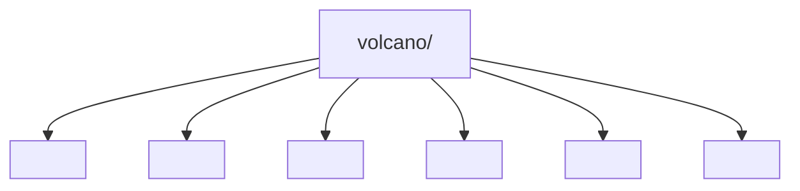
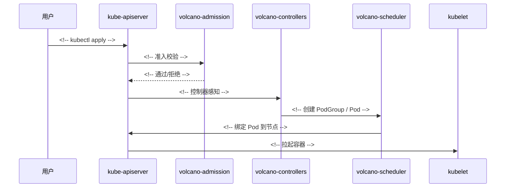

# 项目理解报告

<!--
用法：
  cp templates/report.md reports/<你的名字>/report.md
  然后把所有 TODO 标记换成内容。

三条硬规则：
  1. **不要删除章节**。某一节确实不适用，就写"本节不适用，原因：……"。删节会直接丢分。
  2. **每一句结论后面都要能点出证据位置**（文件:行号 / 实验记录 / 运行输出）。
     写不出证据的句子，要么补证据，要么删掉。
  3. 图和表用 mermaid / Markdown 写**源码**，不要贴截图。老师要的是可复核的图。
-->

# <报告标题：Volcano × 你认领的模块>

| 项 | 内容 |
| --- | --- |
| 姓名 / 学号 | <!-- TODO --> |
| 组内角色 | <!-- 组长 / 组员 --> |
| 分析对象 | Volcano `volcano-sh/volcano` |
| 代码基线 | `v1.15.3`（`d2dd7024f4af3070f9d99d68a78973893908a743`） |
| 我认领的模块 | <!-- 例：pkg/scheduler/plugins/gang --> |
| 运行环境 | Kubernetes <!-- TODO --> / kind / Volcano 镜像 `v1.15.3` |
| 完成日期 | <!-- TODO --> |
| 仓库路径 | `reports/<你的名字>/` |

---

## 评分自查表（交之前自己先打一遍分）

> 用法：把每行等号后面的分数改成你自评的分数，加起来写在最后。
> **低于 80 分不要提 PR** —— 先补最弱的那一项。组长评审时会按这张表复核。

| 维度 | 满分 | 高分特征（讲义原文） | 自评 | 证据在哪 |
| --- | ---: | --- | ---: | --- |
| 项目结构分析 | 15 | 地图准确，能解释阅读顺序 | | §2 |
| 核心类与关系 | 15 | 关系类型准确，有代码证据 | | §3 |
| 调用链分析 | 20 | 端到端、顺序清楚、包含失败路径 | | §4 |
| 代码证据与验证 | 15 | 重要判断可追溯 | | §6.1（≥8 条） |
| 测试理解 | 10 | 能从测试反推边界 | | §5 |
| AI 使用方法 | 10 | 有验证、有纠错、有反思 | | §6.2 / §6.3 |
| 图表与报告 | 15 | 结构清楚、可复用、表达专业 | | 全文 |
| **合计** | **100** | | | |

**五件必交成果是否齐全：**

- [ ] ① 一页项目地图（§2）
- [ ] ② 领域对象图，**≥5 个核心类型**，区分继承与关联（§3）
- [ ] ③ 业务调用链图，**含失败路径**（§4）
- [ ] ④ 证据矩阵，**≥8 条**（§6.1）
- [ ] ⑤ AI 使用反思，**≥2 个帮助 + ≥1 个被纠正**（§6.3）

---

## 1. 项目简介

<!-- 1 页。技术栈、用途、启动方式。注意：这一节是 C 级证据（官方 README/文档）就够，
     但要标明你读的是哪个版本的 README。 -->

| 项 | 内容 |
| --- | --- |
| 项目是什么 | <!-- TODO：一句话 --> |
| 解决什么问题 | <!-- TODO --> |
| 语言 / 构建 | <!-- Go / Makefile / go.mod --> |
| 技术栈分类 | <!-- 参照教材的分类法：运行时依赖 / 调度框架 / 客户端 / 测试框架 / 观测 --> |
| 启动方式 | <!-- TODO：怎么把系统跑起来，命令写出来 --> |
| 代码规模 | <!-- TODO：文件数、主要目录数，给出统计命令 --> |

**技术栈按职责分类**（教材 §2.2 的做法：先分类，不逐个背依赖）：

| 类别 | 本项目的对应物 | 证据位置 |
| --- | --- | --- |
| 入口 / 进程 | <!-- cmd/scheduler、cmd/controller-manager、cmd/webhook-manager --> | |
| 业务核心 | | |
| 数据访问 | <!-- client-go / informer / 本地缓存 --> | |
| 配置 | | |
| 测试 | <!-- Go test / test/e2e --> | |
| 构建与部署 | <!-- Makefile / Helm chart --> | |

---

## 2. 项目地图 ★交付物①

> 一页。根目录、核心包、配置、测试、入口，一个都不能少。
> **先自己看，再看 AI** —— 先让 AI 画地图，你就只是抄了一遍，答辩第 5 问会答不上来。

### 2.1 根目录地图



| 区域 | 是什么 | 为什么值得先看 | 我的验证位置 |
| --- | --- | --- | --- |
| 构建 | | | |
| 入口 | | | |
| 业务代码 | | | |
| 配置 | | | |
| 测试 | | | |
| 部署 | | | |

### 2.2 我的模块在整体中的位置

<!-- TODO：把你的模块放进全局结构里，画出它和上下游的关系。
     这是"项目地图"和"我认领的模块"之间的桥接，别省。 -->

### 2.3 阅读顺序与理由

<!-- TODO：如果只有 30 分钟，按什么顺序读？为什么是这个顺序？
     这一小节直接对应评分项"能解释阅读顺序"。 -->

1. 先读 <!-- TODO -->，因为 <!-- TODO -->
2. 再读 <!-- TODO -->，因为 <!-- TODO -->
3. 最后读 <!-- TODO -->，因为 <!-- TODO -->

### 2.4 我修正掉的错误判断

<!-- TODO：至少一条。例："我一开始以为 pkg/controllers 只处理 vcjob，
     后来发现它还管 Queue 和 PodGroup 的生命周期，证据：pkg/controllers/ 下的 xxx。"

     教材明确说这是最常见的错误姿势（"把包结构当架构"），
     主动写出修正过程是加分项。 -->

---

## 3. 领域对象 ★交付物②

> **至少 5 个核心类型**，且**区分继承与关联**。
> ⚠️ 本项目是 Go：**没有继承**。请按
> [教师要求解读 §8](../docs/00-教师要求解读.md) 的映射表标注关系类型，
> 并在图注里说明 Go 的类型关系。这本身就是 §3 的一个分析点。

### 3.1 领域名词清单（名词法）

<!-- 教材做法：先列业务名词，再确认哪些真正被建模成类型。 -->

| 业务名词 | 是否被建模成类型 | 类型名 | 定义位置 |
| --- | --- | --- | --- |
| 作业 | | | |
| 任务 | | | |
| 队列 | | | |
| 调度组 | | | |
| 节点 | | | |
| 资源 | | | |
| <!-- 补充 --> | | | |

### 3.2 领域对象图

```mermaid
classDiagram
    class JobInfo {
        <!-- 字段 -->
    }
    class PodGroupInfo {
    }
    class QueueInfo {
    }
    class NodeInfo {
    }
    class Resource {
    }
    JobInfo --> PodGroupInfo : <!-- 关联：持有什么字段 -->
    PodGroupInfo --> QueueInfo : <!-- 关联 -->
    NodeInfo --> Resource : <!-- 关联 -->
    <!-- 接口实现请用 ..|> 语法，并在图注说明这是 Go 的隐式实现 -->
```

**图例与关系说明**（这一节是得分点，别省）：

| 边 | 关系类型 | 代码证据 | 为什么不是另一种关系 |
| --- | --- | --- | --- |
| A → B | 关联（字段持有） | `file.go:123` 字段 `xxx` | 不是调用，方法体里没有实际调用 |
| A ⇢ B | 依赖（参数注入） | `file.go:45` 构造参数 | 不是关联，A 不持有 B |
| A ⇠ B | 实现（Go 隐式接口） | <!-- 哪个方法集满足了哪个接口 --> | **Go 没有 extends**，不要画成继承 |
| A → B | 嵌入（embedding） | | **嵌入 ≠ is-a**，按组合处理 |

### 3.3 核心类责任卡（≥5 个）

| 类型 | 一句话责任 | 关键状态 | 关键行为 | 关系 | **删除它会影响什么** | 证据位置 |
| --- | --- | --- | --- | --- | --- | --- |
| | | | | | | |
| | | | | | | |
| | | | | | | |
| | | | | | | |
| | | | | | | |

> 最后一列「删除影响」直接对应**答辩第 1 问**，写具体一点。

### 3.4 最容易误判的一条关系（★答辩第 2 问）

<!-- TODO：
     选一条你自己都犹豫过的边，写清楚：
       1. 一开始以为是哪种关系？
       2. 什么证据让你改了判断？
       3. 如果老师反问"你为什么确定不是另一种"，你怎么答？
     这一小节写好了是明显的加分点。 -->

---

## 4. 业务调用链 ★交付物③

> 20 分，全卷最贵的一项。要求：**端到端、顺序清楚、包含失败路径**。

### 4.1 我选的用户动作

<!-- TODO：一句话描述触发点，例如"用 kubectl 提交一个 minAvailable=4 的 VolcanoJob"。
     选它的理由：有明确的开始和结束，能观察到数据变化。 -->

### 4.2 成功路径



### 4.3 调用链证据表

| # | 步骤 | 执行者（类/方法） | **框架 or 项目代码** | 观察到的事实 | 证据位置 |
| ---: | --- | --- | --- | --- | --- |
| 1 | 用户提交 | | | | |
| 2 | 准入校验 | | | | |
| 3 | 控制器建对象 | | | | |
| 4 | 进入调度周期 | | | | |
| 5 | Action 执行 | | | | |
| 6 | 插件决策 | | | | |
| 7 | 写回绑定 | | | | |

> 「框架 or 项目代码」这一列直接对应**答辩第 3 问**，每一行都要填。

### 4.4 失败路径（必填，占分）

<!-- TODO：构造一个失败场景并真实跑一遍，例如：
       minAvailable 大于集群可提供的资源 → PodGroup 停在 Inqueue → Pod 一直 Pending。
     记录：触发条件、观察到什么、代码里哪一步放弃、日志里对应哪一行。 -->

```mermaid
sequenceDiagram
    <!-- 失败路径 -->
```

| # | 步骤 | 观察到的事实 | 证据位置 |
| ---: | --- | --- | --- |
| 1 | | | |

### 4.5 运行验证记录

<!-- TODO：列出支撑本条调用链的运行记录（A 级证据）。
     每份记录放在 reports/<你的名字>/experiments/ 下，格式见 templates/experiment.md。 -->

| 编号 | 验证了什么 | 记录文件 | 结论 |
| --- | --- | --- | --- |
| 001 | | [experiments/001-*.md](experiments/001-*.md) | |

---

## 5. 测试与边界

> 10 分。考的不是"你会不会写测试"，是**能不能从测试反推契约**。

### 5.1 项目现有测试的组织方式

| 类型 | 位置 | 用什么框架 | 覆盖什么 |
| --- | --- | --- | --- |
| 单元测试 | `pkg/**/*_test.go` | | |
| 端到端测试 | `test/e2e/` | | |
| <!-- 其他 --> | | | |

### 5.2 用 Arrange–Act–Assert 拆一个测试

<!-- TODO：挑一个和你模块相关的测试文件，拆开讲。 -->

| 阶段 | 这个测试做了什么 | 我的理解 |
| --- | --- | --- |
| **Arrange** | | 它构造了一个什么样的世界？ |
| **Act** | | 真正执行了什么动作？ |
| **Assert** | | 作者认为"正确"是什么？ |
| **Infer** | | **这定义了什么契约？改坏什么会被它挡住？** |

### 5.3 失败路径测试

<!-- TODO：教材明确说"维护中最容易被破坏的往往正是失败路径"。
     至少分析一个失败/异常路径的测试，或指出项目缺少哪一类失败路径测试。 -->

### 5.4 我设计的一个新增边界测试

> 教材 §6.4：**先写"测试意图"，再考虑测试代码。** 本报告只要求写意图，不要求实现。

先补全这句话：

> **当 ______ 时，系统应该 ______，并且不应该 ______。**

| 项 | 内容 |
| --- | --- |
| 测试名称 | |
| 前置条件 | |
| 操作 | |
| 期望结果 | |
| 为什么重要 | |
| 这个边界应该由谁负责（校验/控制器/调度器） | |
| 现有测试是否已覆盖 | |
| 证据位置 | |

---

## 6. 代码证据与 AI 使用

### 6.1 证据矩阵 ★交付物④

> **至少 8 条**。等级用 A/B/C/D（见 [教师要求解读 §5](../docs/00-教师要求解读.md)）。
> ⚠️ **不要 8 条全打"确认"** —— 那说明你没真的核验。至少 2 条应为"修正"。

| # | 我原本的判断 / AI 的结论 | 等级 | 证据位置 | 结果 | 修正后的理解 |
| ---: | --- | :---: | --- | :---: | --- |
| 1 | | | | 确认/修正 | |
| 2 | | | | | |
| 3 | | | | | |
| 4 | | | | | |
| 5 | | | | | |
| 6 | | | | | |
| 7 | | | | | |
| 8 | | | | | |

**A 级证据统计**：<!-- TODO：共 __ 条。少于 2 条的话，说明你还没真跑过，请回去跑。 -->

### 6.2 AI 使用日志

> 保留**原始提问**和**AI 的原话**，不要只写"我问了 AI，它说得对"。

| # | 我的提问（原文） | AI 的核心结论 | 我的核验方式 | 结果 | 修正后的模型 |
| ---: | --- | --- | --- | :---: | --- |
| 1 | | | | 确认/修正 | |
| 2 | | | | | |
| 3 | | | | | |

### 6.3 AI 使用反思 ★交付物⑤

**AI 帮助显著的地方（至少 2 个）**

1. <!-- TODO：哪个环节？为什么它比你自己翻代码快？ -->
2. <!-- TODO -->

**AI 被代码纠正的地方（至少 1 个，★答辩第 4 问）**

| 项 | 内容 |
| --- | --- |
| AI 说了什么 | <!-- 抄原话 --> |
| 为什么听起来合理 | <!-- 这是关键：它套用了什么常见模式？ --> |
| 我是怎么发现的 | <!-- 具体动作：搜了什么、跑了什么、读了哪个文件 --> |
| 代码事实是什么 | <!-- 带文件:行号 --> |
| 对我的启发 | <!-- 下次遇到类似情况怎么更快识破 --> |

**我总结的提问经验**

<!-- TODO：什么样的问法能得到可验证的答案？什么样的问法只会得到套话？
     可以对照教材附录 A 的提示词卡。 -->

---

## 7. 维护观察

> 从"读代码"进入"定位真实问题"。二选一做深。

### 选项 A：分析一个真实 Issue

**Issue 分析卡**

| 项 | 内容 |
| --- | --- |
| Issue 编号 / 链接 | |
| 现象（用户观察到什么） | |
| 最小复现步骤 | |
| 入口（哪个命令/请求首先相关） | |
| 涉及的公共抽象 / 公共校验 | |
| 受影响的类型 | |
| 相关的现有测试 | |
| 最小修复应该改哪里、补什么测试 | |
| 该 Issue 当前状态 | <!-- open / closed / 已修复，修复 PR 是哪个 --> |

> ⚠️ 教材提醒：**Issue 里给出的"可能修复方案"本身也不是真相**，
> 要结合当前代码、维护者讨论和测试判断。

### 选项 B：读一次代码历史

<!-- TODO：选一次有意义的提交，回答：
     修改前后职责是否变化？测试是否同时变化？提交信息能否解释设计动机？ -->

| 项 | 内容 |
| --- | --- |
| commit | |
| 改了什么 | |
| 为什么改（从提交信息与关联 PR 推断） | |
| 职责是否变化 | |
| 测试是否同步变化 | |
| 我的判断 | |

### 我的一个维护建议

<!-- TODO：基于前面的分析，你认为项目在哪一处最容易出问题、或哪一处文档与代码不一致？
     给出证据。这条可以同步提给上游。 -->

---

## 8. 学习反思 ★答辩第 5 问

### 8.1 这套方法里，哪些部分换项目后仍然有效？

<!-- TODO：至少写 3 条，要具体到"动作"，不要写"要有耐心"这种空话。
     例："先读构建文件判断技术栈分类，再读入口找控制权转移点，这条在任何项目上都成立。" -->

1.
2.
3.

### 8.2 哪些部分依赖本项目 / 本语言，换项目会失效？

<!-- TODO：Go 的类型关系、Kubernetes 的声明式模型……老实写。 -->

### 8.3 我这次做得不好的地方

<!-- TODO：诚实写。评审和答辩时，主动承认短板比被问出来好。 -->

### 8.4 如果重做一次，我会怎么调整顺序

---

## 附录 A：答辩准备（5 问）

> 老师会问这 5 个问题（讲义第 58 页）。**提前写好答案，并标出报告里的位置。**

| # | 问题 | 我的答案（一句话） | 报告位置 |
| ---: | --- | --- | --- |
| 1 | 删掉一个核心类，最先坏掉的功能是什么？依据？ | | §3.3 |
| 2 | 类图里哪条关系最容易被误判？ | | §3.4 |
| 3 | 调用链中哪一步是框架完成、哪一步是项目代码完成？ | | §4.3 |
| 4 | AI 在哪个问题上给了看似合理但不准确的答案？ | | §6.3 |
| 5 | 项目升级后目录变化，你的方法哪些仍然有效？ | | §8.1 |

## 附录 B：我的实验与运行记录索引

| 编号 | 记录文件 | 验证了什么 | A 级证据？ |
| --- | --- | --- | :---: |
| 001 | [experiments/001-*.md](experiments/001-*.md) | | ✅ |

## 附录 C：参考资料

- Volcano `v1.15.3` 源码：`<!-- 具体文件路径 -->`
- 上游设计文档：`volcano/docs/design/<!-- 具体文件 -->`
- 相关 Issue / PR：`<!-- 链接 -->`
- 组内共享材料：[docs/00-教师要求解读.md](../docs/00-教师要求解读.md)、
  [docs/01-architecture.md](../docs/01-architecture.md)、[docs/glossary.md](../docs/glossary.md)
- 其他组员的关联报告：`<!-- 链接 -->`
