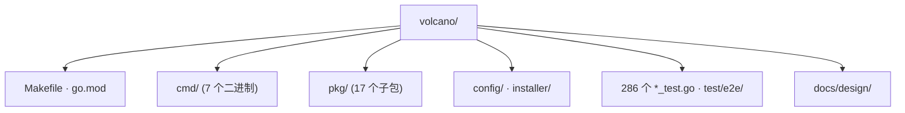

# 实训工作底稿（边做边填）

> **这是过程记录，不是最终报告。** 报告在 `report.md`。
> 对应教材附录 B 的五张表。本文件按**实际发生顺序**记录，不是事后整理。

**分析人**：李鹏飞 ｜ **模块**：`pkg/scheduler/framework/`（Session 生命周期）
**基线**：Volcano `v1.15.3` / `d2dd7024f4af3070f9d99d68a78973893908a743`
**日期**：2026-10-05

---

## B.1 仓库观察表

| # | 观察对象 | 我的第一次判断（未查证） | 证据（文件/目录/命令） | 修正后的理解 |
| ---: | --- | --- | --- | --- |
| 1 | 构建方式 | Maven / Gradle（受教材 Java 影响） | `go.mod:1-3`：`module volcano.sh/volcano` / `go 1.25.0` | Go 模块 + `Makefile`；Go 1.25.0 |
| 2 | 程序入口 | 只有一个 `main.go` | `ls cmd/` → **7 个**二进制 | 7 个独立进程，调度器只是其中之一 |
| 3 | 业务代码位置 | `src/main/java` 式分层 | `ls pkg/` → 17 个子包 | 按**领域**分包（scheduler / controllers / webhooks），不是按技术分层 |
| 4 | 配置位置 | `application.yml` | 实测 ConfigMap `volcano-scheduler-configmap` | 配置在 K8s ConfigMap 里，支持热加载 |
| 5 | 测试位置 | 与源码分离的 `test/` | 286 个 `*_test.go` **就近放在 `pkg/` 里** + `test/e2e/` | 单测同目录，e2e 独立 |
| 6 | 部署方式 | 打包 war 部署 | `installer/helm/chart/volcano` + kind | Helm chart，chart version `1.15.3` |

**我的第一张项目地图**（草稿，最终版见 `report.md` §2.1）：



**★ 最重要的一条观察**（不在表里，但改变了整个分析）：

```bash
$ wc -l pkg/scheduler/scheduler.go
245 pkg/scheduler/scheduler.go
```

`pkg/scheduler/` 有 **257 个 Go 文件**，但作为"调度器主体"的 `scheduler.go`
只有 **245 行**。我第一次判断"调度算法在这里"，错了 —— 见 B.5。

---

## B.2 核心类型卡（≥5 个）

> 教材"六问"：代表什么责任？保存什么状态？公开哪些行为？
> 持有哪些对象/依赖哪些协作者？继承自谁/被谁继承？修改它会影响什么？

| # | 类型名 | 定义位置 | 责任 | 关键状态 | 关键行为 | 关系与协作者 | **删除影响** |
| ---: | --- | --- | --- | --- | --- | --- | --- |
| 1 | `Scheduler` | `pkg/scheduler/scheduler.go:51` | 驱动 1s 周期循环 | `cache` `actions` `plugins` `schedulePeriod` | `Run()` `runOnce()` | 关联 `Cache`/`Action` | 不是算错，是**调度根本不发生** |
| 2 | `Session` | `pkg/scheduler/framework/session.go:65` | 每周期的隔离快照 | `Jobs` `Nodes` `Queues` `cache` `UID` | `openSession` `closeSession` `Allocate` `Statement` | 依赖 `Cache`；被 `Statement` 关联 | 多 Action 在同一缓存上互相踩，结果不可复现 |
| 3 | `Statement` | `pkg/scheduler/framework/statement.go:54` | 决策操作日志 + 提交/回滚 | `operations []operation` `ssn *Session` | `Allocate` `Commit` `Discard` `Merge` | 关联 `Session` | **gang 原子性失效** |
| 4 | `Cache`（interface） | `pkg/scheduler/cache/interface.go:41` | 屏蔽集群状态来源与绑定写回 | — | `Snapshot` `AddBindTask` | 被 `*SchedulerCache` 实现 | 可测试性崩塌（700+ 行测试无法用假缓存驱动） |
| 5 | `Action`（interface） | `pkg/scheduler/framework/interface.go:30` | 可插拔的调度策略 | — | `Execute(ssn)` | 被 8 个 Action 实现 | 策略顺序写死，"默认只启用 3 个 Action"不可配置 |
| 6 | `JobUpdater` | `pkg/scheduler/framework/job_updater.go:47` | Session 关闭时批量回写状态 | `ssn` `jobQueue` | `UpdateAll()`（16 并发） | 关联 `Session` | PodGroup 状态永不更新，用户看不到 `Inqueue` |

### 关系判定记录（每条边都要过一遍这张表）

| 边（A → B） | 候选关系 | 支持证据 | 排除其它关系的理由 | 最终判定 |
| --- | --- | --- | --- | --- |
| `Scheduler → Cache` | 继承/实现/嵌入/关联/依赖/调用 | `scheduler.go:52` 字段 `cache schedcache.Cache` | 是长生命周期字段而非参数 ⇒ 排除依赖；无方法体调用 ⇒ 排除调用 | **关联** |
| `Scheduler → Action` | 同上 | `scheduler.go:59` 字段 `actions []framework.Action` | 同上 | **关联** |
| `SchedulerCache ⇠ Cache` | 同上 | `cache.go:104` `func New(...) Cache { return newSchedulerCache(...) }`；`newSchedulerCache` 在 `:522` 返回 `*SchedulerCache` | 代码里搜不到 `implements` ⇒ 只能靠"具体类型被赋给接口形参"证明；Go 无 extends ⇒ 排除继承 | **实现（隐式）** |
| `*allocate.Action ⇠ Action` | 同上 | `actions/factory.go` `init()`；`framework.RegisterAction(act Action)` 签名 `plugins.go:109` | 同上 | **实现（隐式）** |
| `Session ⇢ Statement` | 同上 | `session.go:709` 返回新对象 | **Session 无任何 Statement 字段** ⇒ 排除组合/关联 | **依赖（创建）** |
| `Statement → Session` | 同上 | `statement.go:56` 字段 `ssn *Session` | 整个生命周期持有 ⇒ 排除依赖 | **关联** |
| `Session → JobInfo` | 同上 | `session.go:88` 字段 `Jobs map[...]*api.JobInfo` | JobInfo 生命周期归 cache ⇒ 不是组合 | **关联** |
| `Session ⇢ Cache` | 同上 | `session.go:166` 参数 `cache cache.Cache` | 入口是**参数注入** ⇒ 依赖；但 Session 也存了 `cache` 字段 ⇒ 两条边都要画 | **依赖 + 关联** |
| `JobUpdater → Session` | 同上 | `job_updater.go:47` 字段 `ssn *Session` | 长期持有 ⇒ 排除依赖 | **关联** |

> ⚠️ **本项目这 6 个核心类型都没用 struct 嵌入**。
> 我一度想在图里找嵌入关系（因为"Go 支持嵌入"），最后确认：
> 硬找嵌入是错误姿势，没有就写没有。

---

## B.3 AI 证据矩阵（≥8 条）

> 等级：**A** 运行/断点/测试 · **B** 源码与配置 · **C** 官方文档 · **D** AI 解释。
> 完整版（13 条）见 `report.md` §6.1。这里记录**判断被推翻的瞬间**。

| # | AI 结论 / 我的初步判断（原话） | 等级 | 证据位置（文件:行号 / 命令 / 记录） | 结果 | 修正后的理解 |
| ---: | --- | :---: | --- | :---: | --- |
| 1 | "分配逻辑在 `Session.Allocate`（`session.go:755`）" | **A** | 运行日志 `statement.go:277` | **修正** | 实际走 `Statement.Allocate`（`statement.go:246`） |
| 2 | "gang 失败 = Pod 长期 Pending" | **A** | 实验 002：`kubectl get pods` → `No resources found` | **修正** | 存在更早的失败点：**Pod 从未被创建** |
| 3 | "队列不设 capability 就总是允许入队"（**代码注释原话** `proportion.go:412`） | **A** | `proportion.go:132-138`；实验 003 准备阶段实测被拒 | **修正** | 该 nil 判断**不可达**；无 capability 仍受集群富余量约束 |
| 4 | "PodGroup.phase 由调度器设置" | **A** | `job_controller_actions.go:407`；实验 002 恒为 `Pending` | **修正** | `Pending` 是控制器初始值；只有 `enqueue` 能推成 `Inqueue` |
| 5 | "closeSession 统一把决策刷进 etcd" | **A** | `cache.go:874`（20ms 轮询）；`statement.go:320` | **修正** | 写回在 cache 侧**独立异步 worker**；closeSession 只回写状态 |
| 6 | "记录决策 = 写回 etcd" | **A** | 实验 003：`statement.go:277` 记录 → `:366` 回滚，etcd 全程无写入 | 确认 | 二者分离；这是 gang 原子性的基础 |
| 7 | "`Discard()` 按记录顺序撤销" | **B** | `statement.go:365-368` `for i := len-1; i >= 0; i--` | **修正** | 是**逆序**（栈展开） |
| 8 | "YAML 里 Queue 写在 Job 前面就够了" | **A** | 实验 004：8 次中 7 次被 webhook 拒绝 | **修正** | 同一 `apply` 无顺序保证 ⇒ 竞态 |
| 9 | "调度周期是事件驱动的" | **A** | `scheduler.go:115`；日志间隔恒 1.001s | 确认 | **纯定时**，默认 1s，空闲也空转 |
| 10 | "调度器直接绑定 Pod" | **A** | `cache.go:1454` `BindTask()`；`cache.go:874` | 确认 | 确实是 Volcano 发起，但是**异步**的 |
| 11 | "Session 组合持有 Statement" | **B** | `session.go:65-165` 无该字段；`statement.go:56` 有 `ssn` | **修正** | 持有方向**相反** |
| 12 | "`docs/design/execution-flow.md` 可直接引用" | **A+C** | 该文档 48 行无版本号；实测 1.001s | 确认 | 结论对，但只用 A 级证据（启动参数）做引用依据 |
| 13 | "共享文档列的 `pkg/scheduler/unschedulable/` 是 v1.15.3 模块" | **B** | `git ls-files \| grep -i unschedulable`；`git merge-base --is-ancestor 5702c0538 HEAD` → NO | **修正** | 该包在 **master**，不在 v1.15.3 |

**A 级证据计数**：**6 条**（目标 ≥2）✅

---

## B.4 调用链记录

> 按**实际执行顺序**填。"框架 or 项目代码"必须填 —— 答辩第 3 问就考这个。

**成功路径**（完整版见 `report.md` §4.3）

| # | 触发（上一步/用户动作） | 执行者（包.类型.方法） | 动作 | 数据变化 | 框架 or 项目代码 | 证据位置 |
| ---: | --- | --- | --- | --- | --- | --- |
| 1 | 用户 `kubectl apply` | kube-apiserver | 写 etcd | vcjob 对象创建 | **框架** | `001-success-path.log` |
| 2 | API 回调 | `volcano-admission` `admit_job.go` | 校验队列 state | 放行 | **项目代码** | `admit_job.go:203-207` |
| 3 | watch 到 Job | `volcano-controllers` Job Controller | 建 PodGroup + 2 Pod | etcd 多 3 个对象 | **项目代码** | `job_controller_actions.go:407` |
| 4 | `wait.Until` 每 1s | `Scheduler.runOnce()` | 开 Session | Session UID | **项目代码** | `scheduler.go:115` `:124` |
| 5 | 开 Session | `openSession()` → `cache.Snapshot()` | 复制快照 | 内存副本 | **项目代码** | `session.go:166` `:229` |
| 6 | 主循环 | `allocate.Action.Execute()` | 按序执行 Action | — | **项目代码** | `scheduler.go:150` |
| 7 | allocate | `gang` 的 `JobReadyFn` | 校验 minAvailable | — | **项目代码** | `gang.go:191-193` |
| 8 | 插件通过 | `Statement.Allocate()` | **只记录** | Session 内存 | **项目代码** | `statement.go:246` `:277` |
| 9 | JobReady | `Statement.Commit()` → `allocate()` | `AddBindTask` 入队 | bindTaskQueue | **项目代码** | `statement.go:392` `:317` `:320` |
| 10 | Action 跑完 | `closeSession()` → `JobUpdater.UpdateAll()` | 回写 **PodGroup 状态** | etcd 状态字段 | **项目代码** | `session.go:558-560` |
| 11 | 独立 goroutine 20ms | `processBindTask()` → `BindTask()` | **绑定写回** | `Pod.spec.nodeName` | **项目代码** | `cache.go:874` `:1379` `:1454` |
| 12 | 绑定完成 | kubelet | 拉起容器 | Pod → Running | **框架** | `001-success-path.log` |

**失败路径**（三条，完整版见 `report.md` §4.4）

| # | 触发 | 执行者 | 动作 | 观察到什么 | 为什么在这里放弃 | 证据位置 |
| ---: | --- | --- | --- | --- | --- | --- |
| A1 | 提交 minAvailable=4 / 32 CPU | `proportion` 插件 `JobEnqueueableFn` | 算 `minReq > realCapability` | 事件 `queue resource quota insufficient` | `proportion.go:438 return util.Reject` | [exp 002](experiments/002-enqueue-gate.md) |
| A2 | enqueue 拒绝 | Job Controller | `syncTask=false` | **Pod 数 = 0**；调度器日志 0 命中 | `job_controller_actions.go:407-409` | 同上 |
| B1 | 提交 minAvailable=2 / 只圈 1 节点 | allocate → `Statement.Allocate` | 记录 worker-0 的分配 | `statement.go:277 After allocated` | —— | [exp 003](experiments/003-gang-discard.md) |
| B2 | worker-1 谓词失败 | allocate | `JobReady()` 为 false | `Insufficient cpu` | —— | 同上 |
| B3 | gang 凑不齐 | `Statement.Discard()` | **逆序**撤销 | `statement.go:366 Discarding` → `:347 Remove Task` | `allocate.go:865` | 同上 |
| C1 | 同文件 apply Queue+Job | `volcano-admission` | 读 informer 缓存 | webhook denied，**8 次中 7 次** | `admit_job.go:203-207` | [exp 004](experiments/004-webhook-race.md) |

**静态追踪 vs 运行追踪的差异** ★ 本次最大收获

| 项 | 静态读代码时我以为 | 实际跑起来 | 在哪里发现不一致 |
| --- | --- | --- | --- |
| 分配逻辑在哪 | `session.go:755 Session.Allocate()` | `statement.go:246 Statement.Allocate()` | `grep "allocated Task"` → 日志前缀是 `statement.go:277` |
| 何时写 etcd | `Commit()` 时 | `Commit()` 只入队，20ms 后由独立 worker 写 | `cache.go:874` 的 `wait.Until` |
| 失败时 Pod 什么样 | 一堆 Pending Pod | 可能**一个 Pod 都没有** | 实验 002 的 `kubectl get pods` |
| 周期怎么触发 | informer 事件 | 纯 1s 定时器 | 日志时间戳恒差 1.001s |

---

## B.5 实训反思

**今天最重要的新理解是什么？**

> **包名的大小不等于职责的大小。**
> `pkg/scheduler/scheduler.go` 听起来是心脏，实际是**节拍器** —— 245 行，
> `runOnce()` 只有 25 行，一行调度算法都没有。
> 真正的算法在 `actions/`，决策记录在 `framework/statement.go`，写回在 `cache/`。
> 我一开始按"目录名 = 职责"的直觉分配了阅读时间，前半小时基本浪费了。

**AI 在哪一步最有帮助？为什么？**

1. **快速铺开"这个类型可能和谁有关系"的候选集**。
   AI 能立刻列出 `Session`/`Statement`/`Cache`/`Action` 的候选关系，
   我再逐个用"数字段"的办法证伪。省掉的是"想不出该查什么"的时间。
2. **把上游设计文档的散文翻译成可验证的断言**。
   `docs/design/execution-flow.md` 是 48 行流程图式散文，
   AI 帮我把它转成"Session 每秒开一次""每次建本地副本"等 5 条可证伪断言，
   我才知道该去日志里找什么。

**AI 在哪一步误导或过度推断？你是怎么发现的？**（★答辩第 4 问）

> AI 说：**"队列不设 capability 就总是允许入队。"**
>
> 它听起来非常合理 —— 因为代码注释里**就是这么写的**
> （`proportion.go:412`：`// If no capability is set, always enqueue the job.`），
> 而且紧跟着就有一个看起来完全对应的守卫
> `:413 if attr.realCapability == nil { return util.Permit }`。
> 一个"注释 + 守卫"配对的形态，任何人都会信。
>
> **怎么发现的**：做实验 003 时我特意**不设** capability，
> 预期作业立刻 Inqueue，结果却收到 `queue resource quota insufficient: insufficient cpu`。
> 反查 `proportion.go:132-138`，发现 `attr.realCapability = realCapability`
> 被写在 `if attr.capability == nil { ... } else { ... }` 的**两个分支里**，
> 所以 `:413` 的 nil 判断**永远不成立**。
>
> **启发**：AI 复述注释时**不会交叉验证注释与实现**。
> 而注释恰恰是最容易腐烂的东西 —— 它没有编译器看着。
> 下次遇到"注释 + 守卫"这种过于整齐的配对，第一反应应该是
> **去确认那个守卫的进入条件是否真的可达**。

**如果换一个完全陌生的项目，我准备保留哪三步方法？**（★答辩第 5 问）

1. **先读入口的最小文件，再展开大文件**（看主循环有多短）。
2. **先数字段，再画箭头**（关系判定不靠语感，靠在不在字段列表里）。
3. **先跑再读**（让运行日志校正静态阅读的猜测，而不是反过来）。

---

## 附：答辩 5 问草稿

| # | 问题 | 我的答案 | 报告位置 | 想好了吗 |
| ---: | --- | --- | --- | :---: |
| 1 | 删掉一个核心类，最先坏掉的功能是什么？依据是什么？ | 删 `Statement` → gang 原子性失效；删 `Scheduler` → 调度不发生（不是算错） | §3.3 | ☑ |
| 2 | 类图里哪条关系最容易被误判？ | `Session` ⇢ `Statement` 持有方向相反 | §3.4 | ☑ |
| 3 | 调用链中哪一步是框架完成、哪一步是项目代码完成？ | 仅第 1、12 步是框架；2–11 全是项目代码。最易答错的是第 11 步绑定 | §4.3 | ☑ |
| 4 | AI 在哪个问题上给了看似合理但实际不准确的答案？ | "无 capability 就总是允许入队" —— 注释与实现不符 | §6.1 #3 | ☑ |
| 5 | 项目升级后目录变化，你的方法哪些仍然有效？ | "先跑再读""先数字段再画箭头""读最小入口文件"三条与目录无关 | §8.1 / §8.2 | ☑ |

---

## 我的执行时间线（供事后复盘）

| 时间 | 动作 | 产出 |
| --- | --- | --- |
| 19:00 | 收窄 title、module 下沉到 `pkg/scheduler/framework/` | `meta.yml` |
| 19:00 | 建分支 `report/lipengfei/scheduler-session`、刷 README 索引 | 1/21 模块已认领 |
| 19:01 | 环境核对（源码/集群/部署三者齐全） | 环境快照 |
| 19:01 | **实验 001** 成功路径 | `experiments/001-*` |
| 19:03 | **实验 002** enqueue 门控（第一次误撞 webhook 竞态） | `experiments/002-*` |
| 19:06 | **实验 003** gang 回滚 | `experiments/003-*` |
| 19:10 | **实验 004** webhook 竞态量化（8 次） | `experiments/004-*` |
| 19:11 | 清理实验资源 | 集群回到干净状态 |
| 19:12 | 写报告 §1–§4 + §6.1 | `report.md` |
