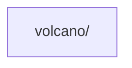

# 实训工作底稿（边做边填）

> **这是过程记录，不是最终报告。** 报告在 `report.md`。
> 本文件对应教材附录 B 的五张表，作用是：**避免"事后回忆式"填写**。
>
> 用法：`cp templates/workbook.md reports/<你的名字>/workbook.md`，然后从第一天就开始填。
> 每写一条判断就立刻记下来 —— 写完再补的"第一次判断"一定是美化过的，老师一追问就露馅。
>
> 最后定稿时，把这里的素材搬到 `report.md` 的对应章节。

---

## B.1 仓库观察表

> 对应报告 §2。**先写判断，再写证据，最后写修正** —— 顺序不要颠倒。

| # | 观察对象 | 我的第一次判断（未查证） | 证据（文件/目录/命令） | 修正后的理解 |
| ---: | --- | --- | --- | --- |
| 1 | 构建方式 | | | |
| 2 | 程序入口 | | | |
| 3 | 业务代码位置 | | | |
| 4 | 配置位置 | | | |
| 5 | 测试位置 | | | |
| 6 | 部署方式 | | | |

**我的第一张项目地图**（手绘/电子均可，草稿放这里或 `assets/`）：

<!-- 建议直接用 mermaid 写，方便 diff 和复用 -->

---

## B.2 核心类型卡（≥5 个）

> 对应报告 §3.3。教材的"六问"：它代表什么责任？保存什么状态？公开哪些行为？
> 持有哪些对象/依赖哪些协作者？继承自谁/被谁继承？修改它会影响什么？

| # | 类型名 | 定义位置 | 责任 | 关键状态 | 关键行为 | 关系与协作者 | **删除影响** |
| ---: | --- | --- | --- | --- | --- | --- | --- |
| 1 | | | | | | | |
| 2 | | | | | | | |
| 3 | | | | | | | |
| 4 | | | | | | | |
| 5 | | | | | | | |
| 6 | | | | | | | |

### 关系判定记录（每条边都要过一遍这张表）

| 边（A → B） | 候选关系 | 支持证据 | 排除其它关系的理由 | 最终判定 |
| --- | --- | --- | --- | --- |
| | 继承/实现/嵌入/关联/依赖/调用 | | | |

> 判断口径：**先找证据，再画箭头。**
> - `extends / implements` → 继承 / 实现
> - 字段是另一个对象或集合 → 关联 / 聚合
> - 构造参数或函数参数是某接口 → 依赖
> - 方法体里实际执行了 `b.Method()` → 调用（**画到调用链图，不要画在类图**）
>
> ⚠️ Go 没有 `extends`。详见 [教师要求解读 §8](../docs/00-教师要求解读.md)。

---

## B.3 AI 证据矩阵（≥8 条）

> 对应报告 §6.1。等级：**A** 运行/断点/测试 · **B** 源码与配置 · **C** 官方文档 · **D** AI 解释。
>
> 填表纪律：
> - "AI 结论"要抄**原话**，不要转述；
> - 结果只填 `确认` 或 `修正`；
> - **至少 2 条必须是"修正"**，否则说明你没真核验。

| # | AI 结论 / 我的初步判断（原话） | 等级 | 证据位置（文件:行号 / 命令 / 记录） | 结果 | 修正后的理解 |
| ---: | --- | :---: | --- | :---: | --- |
| 1 | | | | | |
| 2 | | | | | |
| 3 | | | | | |
| 4 | | | | | |
| 5 | | | | | |
| 6 | | | | | |
| 7 | | | | | |
| 8 | | | | | |
| 9 | | | | | |

**A 级证据计数**：____ 条（目标 ≥2）

---

## B.4 调用链记录

> 对应报告 §4.3。按**实际执行顺序**填，不要按代码目录顺序填。
> "框架 or 项目代码"这一列必须填 —— 答辩第 3 问就考这个。

**成功路径**

| # | 触发（上一步/用户动作） | 执行者（包.类型.方法） | 动作 | 数据变化 | 框架 or 项目代码 | 证据位置 |
| ---: | --- | --- | --- | --- | --- | --- |
| 1 | | | | | | |
| 2 | | | | | | |
| 3 | | | | | | |
| 4 | | | | | | |
| 5 | | | | | | |
| 6 | | | | | | |
| 7 | | | | | | |
| 8 | | | | | | |

**失败路径**（必填）

| # | 触发 | 执行者 | 动作 | 观察到什么 | 为什么在这里放弃 | 证据位置 |
| ---: | --- | --- | --- | --- | --- | --- |
| 1 | | | | | | |
| 2 | | | | | | |

**静态追踪 vs 运行追踪的差异**

<!-- TODO：静态读代码时你以为会走哪条分支？实际跑起来走了哪条？在哪里发现不一致？ -->

---

## B.5 实训反思

> 对应报告 §6.3 与 §8。

**今天最重要的新理解是什么？**

**AI 在哪一步最有帮助？为什么？**

**AI 在哪一步误导或过度推断？你是怎么发现的？**（★答辩第 4 问）

**如果换一个完全陌生的项目，我准备保留哪三步方法？**（★答辩第 5 问）

---

## 附：答辩 5 问草稿

> 提前写，别临场想。写完回头检查报告里有没有对应位置。

| # | 问题 | 我的答案 | 报告位置 | 想好了吗 |
| ---: | --- | --- | --- | :---: |
| 1 | 删掉一个核心类，最先坏掉的功能是什么？依据是什么？ | | §3.3 | ☐ |
| 2 | 类图里哪条关系最容易被误判？ | | §3.4 | ☐ |
| 3 | 调用链中哪一步是框架完成、哪一步是项目代码完成？ | | §4.3 | ☐ |
| 4 | AI 在哪个问题上给了看似合理但实际不准确的答案？ | | §6.3 | ☐ |
| 5 | 项目升级后目录变化，你的方法哪些仍然有效？ | | §8.1 | ☐ |
